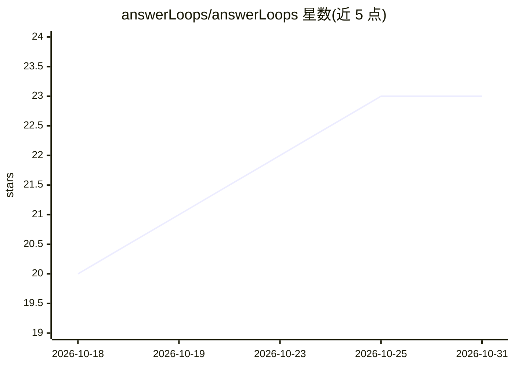

# answerLoops/answerLoops

⭐ 23 · TypeScript · AGPL-3.0 · 推送 2026-10-30 · [GitHub](https://github.com/answerLoops/answerLoops) · [官网](https://answerloops.com) · 组织维护

**面向社区的自托管 AI 客服系统：来源支撑回答+双 Agent 审核**

为 Discord、Slack、Discourse、GitHub、Telegram 等社区渠道提供 AI 支持的自托管系统：从文档、文件、GitHub 仓库与 Notion 导入知识，生成带来源的回答草稿，由第二个 AI Agent 对照来源审核并给出置信度，经团队批准或开启自动回复后发出；有用结论可沉淀为知识文章。附带统一工单收件箱（分诊、SLA、人工升级、CSAT）。支持 OpenAI、Anthropic、Gemini、Groq、Mistral、Ollama 等 AI 提供商，提供 MCP、REST、OpenAPI 与 TypeScript SDK。以 Docker Compose 栈自托管，AGPL-3.0 许可，也有托管版。

## 筛选速览

| 维度 | 判定 | 备注 |
|---|---|---|
| AI 角色 | `ai-native` | 本体是模型或模型工具 |
| 许可风险 | `viral` | AGPL-3.0 |
| 部署形态 | `self-host` | docker 或自建部署 |
| 模型依赖 | local-ok | 支持本地模型 |
| 硬件要求 | — | 无带数字的原话,不猜 |
| 安装摩擦 | `low` | 无编译、无系统依赖或容器化 |
| 成熟度 | — | 结构信号不足 |

## 能力要点

- 双 Agent 流水线：草稿生成+来源审核+置信度评分，自动回复默认关闭
- 9 类社区渠道接入共享同一知识库与工单队列
- 支持 OpenAI/Anthropic/Gemini/Groq/Mistral/Ollama 及任意 OpenAI 兼容端点（含本地模型）
- 提供 MCP server、REST/OpenAPI、TypeScript SDK 与 Claude Code skills

## 适用场景

- 社区/客服团队用自有文档自动回答重复提问
- 在自有基础设施上运行带审核流程的 AI 客服
- 通过 MCP/API 将自有 agent 接入知识库与工单系统

## 场景标签

`聊天机器人` `文档问答` · 领域:对话与助手

## 证据(README 行号)

> L9:  Self-hostable AI support for your community. Source-backed replies, checked by a second AI Agent, and approved by y
> L30: - **Review.** A second AI Agent checks each draft against its sources. Your team approves it, or you turn on auto-r

## 星数曲线

2026-10-18 20 → 2026-10-31 23（+3）

---
*卡片 v1 · prompt 1.4 · 生成 2026-10-27 · 置信度 high · 依据 README sha `3bfc58e2ca9b` · [字段定义](../../DATASET.md)*
