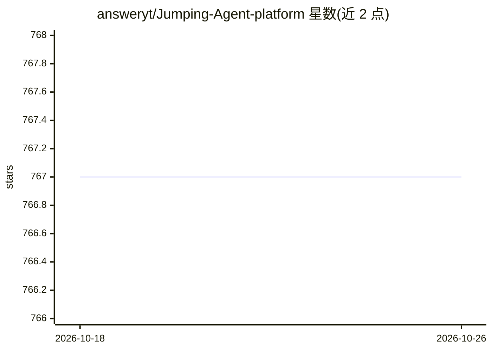

# answeryt/Jumping-Agent-platform

⭐ 767 · TypeScript · Apache-2.0 · 推送 2026-09-17 · [GitHub](https://github.com/answeryt/Jumping-Agent-platform) · 个人维护 · 中文 README

**跳一跳游戏化 Agent 构建平台：零基础用户搭建自己的智能体**

以跳一跳游戏交互呈现的 Agent 构建平台：用 Three.js 跳台 UI 替代平面 workflow 连线，零基础用户通过按压跳跃操作配置节点，后端 orchestrator 结合 agent_builder 骨架与模板生成 Agent workspace，back_agent 依据用户需求补全 Agent 代码。支持微信扫码绑定后在微信中与 Agent 对话（iLink 连接器长轮询转发）。需 OpenAI API Key，从源码运行需启动三个服务；当前仅 7 种工作流模板，构建流程尚不稳定，为个人独立开发项目。

## 筛选速览

| 维度 | 判定 | 备注 |
|---|---|---|
| AI 角色 | `ai-ecosystem` | LLM/agent 周边工具 |
| 许可风险 | `permissive` | Apache-2.0 |
| 部署形态 | `library` | 以包/库形式分发 |
| 模型依赖 | — | README 未给出锁定关系 |
| 硬件要求 | — | 无带数字的原话,不猜 |
| 安装摩擦 | `low` | 无编译、无系统依赖或容器化 |
| 成熟度 | `idea` | |

## 能力要点

- 跳一跳式空间化界面替代平面 workflow 连线
- 微信扫码绑定后在微信中与自建 Agent 对话
- orchestrator 动态加载骨架并生成 Agent workspace
- 支持 iPad 局域网访问前端

## 适用场景

- 零基础用户以游戏化方式搭建个人 Agent
- 构建后在微信里直接与自己的 Agent 对话
- 在平板上通过局域网访问进行 Agent 编排

## 场景标签

`Agent 框架` `工作流自动化` · 领域:Agent 开发

## 证据(README 行号)

> L3:  通过游戏方式，将平面智能体构建改为空间化智能体构建，让小白轻松上手
> L12: 本项目把传统平面 workflow 转换为空间化、游戏化流程，通过跳一跳这个载体更动态地演示 Agent 的运行过程。
> L67: - **`backend/`**：编排服务。`orchestrator.py` 负责串联前端请求、动态加载 `agent_builder`、生成 Agent workspace、通过本地 HTTP 调用 `back_agent`，

## 星数曲线

2026-10-18 767 → 2026-10-26 767（+0）

---
*卡片 v1 · prompt 1.4 · 生成 2026-10-21 · 置信度 high · 依据 README sha `5a97a4e2685d` · [字段定义](../../DATASET.md)*
