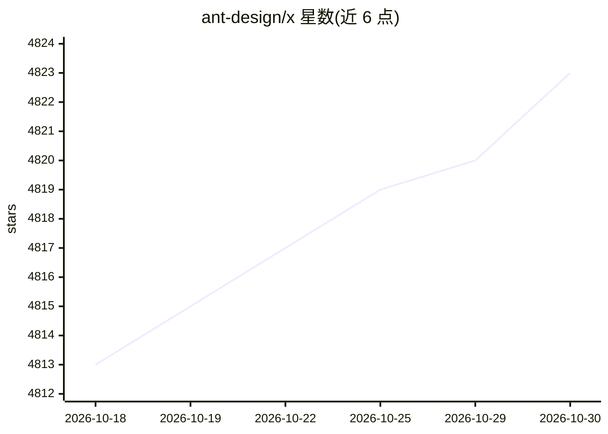

# ant-design/x

⭐ 4,823 · TypeScript · 推送 2026-10-29 · [GitHub](https://github.com/ant-design/x) · [官网](https://x.ant.design) · 组织维护 · 中文 README

**蚂蚁开源的 React AI 聊天界面组件库**

Ant Design X 提供面向 LLM 应用的 React 组件体系，包含 @ant-design/x（基于 RICH 交互范式的原子组件）、@ant-design/x-sdk（管理 AI 应用数据流、连接模型 Agent 的工具 API）、@ant-design/x-markdown（流式 Markdown 渲染器，支持公式、代码高亮、mermaid）、@ant-design/x-card（基于 A2UI 协议的动态卡片渲染）与 @ant-design/x-skill（Agent 技能库）。面向构建 AI 对话界面的前端开发者，npm 包分发，蚂蚁集团内部使用。

## 筛选速览

| 维度 | 判定 | 备注 |
|---|---|---|
| AI 角色 | `ai-ecosystem` | LLM/agent 周边工具 |
| 许可风险 | `none` | — |
| 部署形态 | `library` | 以包/库形式分发 |
| 模型依赖 | — | README 未给出锁定关系 |
| 硬件要求 | — | 无带数字的原话,不猜 |
| 安装摩擦 | `low` | 无编译、无系统依赖或容器化 |
| 成熟度 | — | 结构信号不足 |

## 能力要点

- RICH 交互范式覆盖各交互阶段的 LLM 原子组件
- @ant-design/x-sdk 连接模型 Agent 并管理数据流
- 流式 Markdown 渲染器支持公式/代码高亮/mermaid
- 基于 A2UI 协议的动态卡片渲染组件

## 适用场景

- 快速搭建企业级 AI 聊天/copilot 界面
- 管理 LLM 流式输出的前端数据流
- 流式渲染 AI 回复中的 Markdown、公式与图表

## 场景标签

 · 领域:前端/AI 界面组件

## 证据(README 行号)

> L18: ## 🌈 Enterprise-level LLM Components Out of the Box
> L20: `@ant-design/x` provides a rich set of atomic components for different interaction stages based on the RICH interac
> L22: ## ⚡️ Connect to Model Agents & Efficiently Manage Data Streams
> L24: `@ant-design/x-sdk` provides a set of utility APIs to help developers manage AI application data streams out of the

## 星数曲线

2026-10-18 4,813 → 2026-10-30 4,823（+10）

---
*卡片 v1 · prompt 1.4 · 生成 2026-10-20 · 置信度 high · 依据 README sha `5416d6b6c05f` · [字段定义](../../DATASET.md)*
