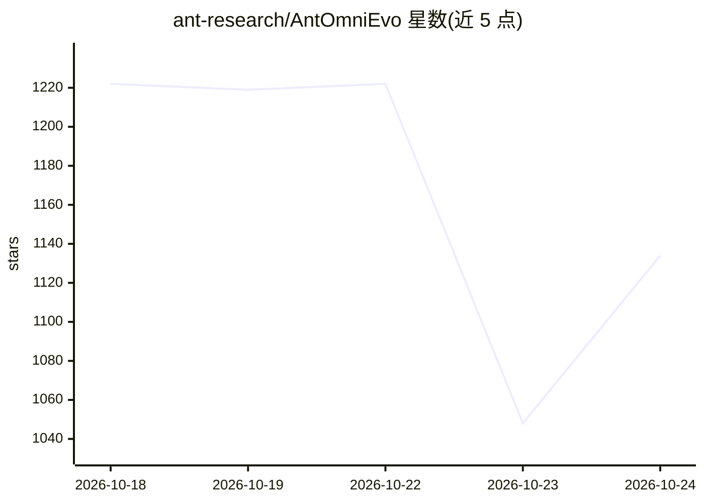

# ant-research/AntOmniEvo

⭐ 1,164 · Python · Apache-2.0 · 推送 2026-10-20 · [GitHub](https://github.com/ant-research/AntOmniEvo) · 组织维护 · 中文 README

**AI agent 系统的自动进化优化框架：代理自动改写可调文件**

将系统的可调部分（技能目录、prompt、workflow 配置、pipeline 代码、单文件算法）抽象为可调产物目录，运行并发进化循环：用户定义系统运行方式、评分器、数据与产物结构，框架负责调度、预算、选择淘汰与持久化（可中断恢复），coding-agent Proposer 读取失败轨迹并像人一样改写文件产生新候选，最终交付带变更谱系的最优产物目录。适用于任何可用文件目录表达且评估可重复的系统；被优化系统本身无需包含 LLM，但提案者须为 agent。附带场景化 Agent Skills（当前含 eddy 实验技能，中文内容）与双语文档。

## 筛选速览

| 维度 | 判定 | 备注 |
|---|---|---|
| AI 角色 | `ai-ecosystem` | LLM/agent 周边工具 |
| 许可风险 | `permissive` | Apache-2.0 |
| 部署形态 | `None` |  |
| 模型依赖 | — | README 未给出锁定关系 |
| 硬件要求 | — | 无带数字的原话,不猜 |
| 安装摩擦 | `low` | 无编译、无系统依赖或容器化 |
| 成熟度 | — | 结构信号不足 |

## 能力要点

- 可调产物抽象：技能/prompt/workflow 配置/单文件算法皆可作为优化基因组
- 分工模式：用户定义、框架控制循环、coding-agent Proposer 执行修改
- CandidateStore 持久化全部候选与变更谱系，支持中断续跑
- 附带场景化 Agent Skills 驱动实验搭建

## 适用场景

- 自动迭代优化我的 agent 技能目录与系统 prompt
- 对检索 pipeline 的配置与节点代码做进化式调优
- 让 agent 依据失败轨迹持续改进单文件算法

## 场景标签

`编码 Agent` `Agent 框架` · 领域:Agent 开发

## 证据(README 行号)

> L9: **AntOmniEvo** is an auto-evolution framework with a strict division of labor: **you define your system's tunable ar
> L15: AntOmniEvo is an auto-evolution framework for AI agent systems. It treats your system's **tunable artifacts** (skil
> L25: **Division of labor: you define, framework controls, AI works.**

## 星数曲线

2026-10-18 1,222 → 2026-10-24 1,134（-88）

---
*卡片 v1 · prompt 1.4 · 生成 2026-10-21 · 置信度 high · 依据 README sha `a3e991629dca` · [字段定义](../../DATASET.md)*
