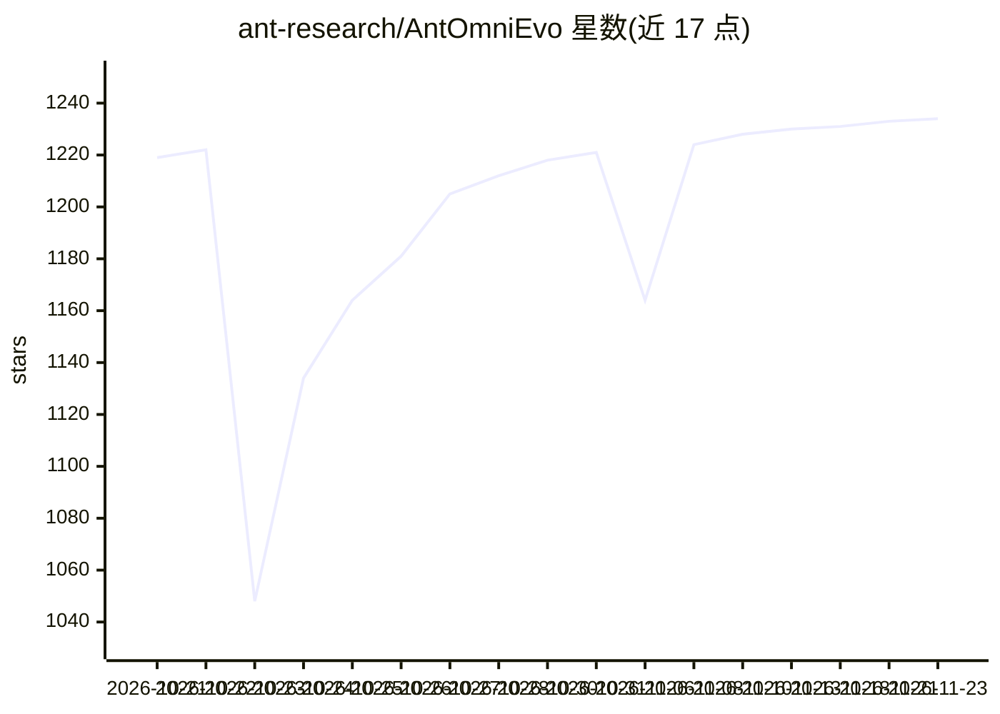

# ant-research/AntOmniEvo

⭐ 1,234 · Python · Apache-2.0 · 推送 2026-11-17 · [GitHub](https://github.com/ant-research/AntOmniEvo) · 组织维护 · 中文 README

**面向 AI agent 系统的自动进化优化框架**

将系统的可调部分（skills、prompts、workflow 配置、pipeline 代码）抽象为可调工件目录，并以其为'基因组'运行并发进化循环：用户定义运行方式、评分器、训练/验证数据与工件模式，框架负责调度、预算、选择淘汰、持久化与断点恢复，coding-agent Proposer 读取失败轨迹并重写工件生成新候选，最终交付带变更谱系的最优候选目录。被优化系统本身无需包含 LLM。随附 eddy 场景的实验技能模板及论文数据集仓库。

## 筛选速览

| 维度 | 判定 | 备注 |
|---|---|---|
| AI 角色 | `ai-ecosystem` | LLM/agent 周边工具 |
| 许可风险 | `permissive` | Apache-2.0 |
| 部署形态 | `None` |  |
| 模型依赖 | — | README 未给出锁定关系 |
| 硬件要求 | — | 无带数字的原话,不猜 |
| 安装摩擦 | `low` | 无编译、无系统依赖或容器化 |
| 成熟度 | — | 结构信号不足 |

## 能力要点

- 以文件目录为载体的可调工件抽象，优化过程即文件编辑
- 框架控制进化循环：调度、预算、选择淘汰、CandidateStore 持久化与可恢复
- coding-agent Proposer 依据失败轨迹重写工件并记录变更归因
- skills/ 提供按场景驱动的实验搭建 Agent Skill 模板

## 适用场景

- 自动进化 agent 的 skill / harness / memory 目录
- 迭代优化检索 DAG 等 workflow 配置与节点代码
- 对单文件算法进行基于评估分数的自动改写

## 场景标签

`Agent 框架` · 领域:Agent 开发

## 证据(README 行号)

> L9: **AntOmniEvo** is an auto-evolution framework with a strict division of labor: **you define your system's tunable ar
> L15: AntOmniEvo is an auto-evolution framework for AI agent systems. It treats your system's **tunable artifacts** (skil
> L37: **The framework controls** — it runs the evolution loop, and all the control and engineering work inside it: schedu

## 星数曲线

2026-10-21 1,219 → 2026-11-23 1,234（+15）

---
*卡片 v1 · prompt 1.4 · 生成 2026-11-23 · 置信度 high · 依据 README sha `53cc5cd84795` · [字段定义](../../DATASET.md)*
