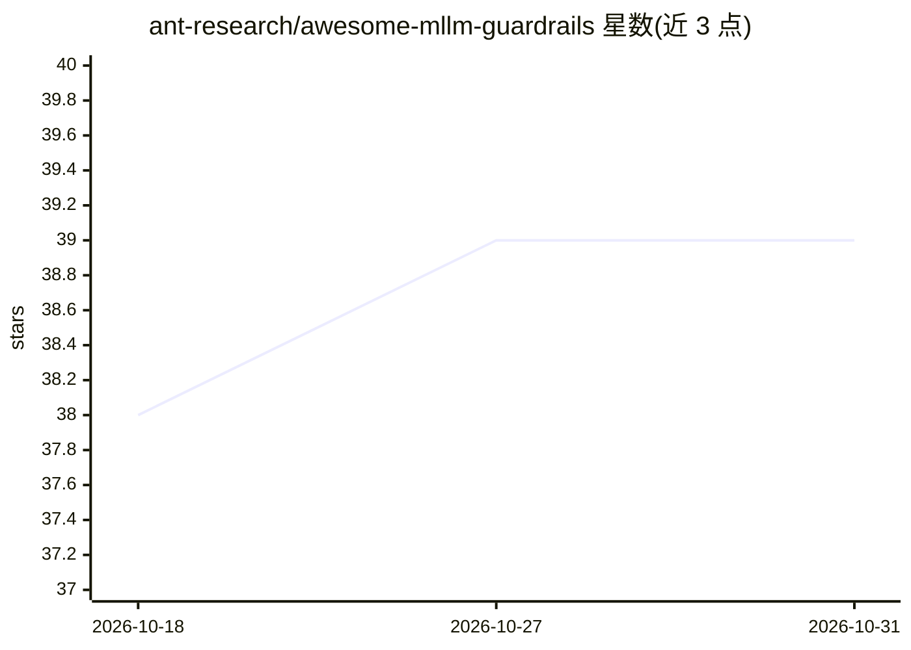

# ant-research/awesome-mllm-guardrails

⭐ 39 · Apache-2.0 · 推送 2026-10-07 · [GitHub](https://github.com/ant-research/awesome-mllm-guardrails) · 组织维护 · 中文 README

**LLM/MLLM 安全护栏资源策展清单：基准、护栏模型、攻击与数据集**

由 ant-research 维护的 LLM 与多模态 LLM 安全护栏资源聚合清单，按实践流程组织条目：按模态（文本/图像/视频/多模态/对话）选择基准与数据集，选择护栏模型基线，测试越狱与注入攻击，并将护栏接入运行时系统。条目以表格形式给出论文名、发表会议与年份、模态标记和简介链接，覆盖 SafePyramid、Aegis2、HarmBench、JailbreakV-28K、LeanGuard 等，接受 issue 与 PR 贡献，README 提供中英双语。

## 筛选速览

| 维度 | 判定 | 备注 |
|---|---|---|
| AI 角色 | `ai-knowledge` | 知识聚合/清单类 |
| 许可风险 | `permissive` | Apache-2.0 |
| 部署形态 | `None` |  |
| 模型依赖 | — | README 未给出锁定关系 |
| 硬件要求 | — | 无带数字的原话,不猜 |
| 安装摩擦 | `low` | 无编译、无系统依赖或容器化 |
| 成熟度 | — | 结构信号不足 |

## 能力要点

- 按模态（T/I/V/M/D）分类的文本与多模态安全基准表
- 护栏模型条目含低延迟、免训练、流式审核等多种机制描述
- 覆盖越狱攻击、审核数据集、评测套件与部署框架
- 中英双语 README，开放 issue/PR 贡献

## 适用场景

- 为 LLM/MLLM 应用挑选合适的安全基准与护栏模型
- 查找越狱攻击与红队评测资源
- 了解护栏方向的论文与数据集覆盖范围

## 场景标签

`精选清单` `网络安全` · 领域:学习与行业

## 证据(README 行号)

> L7: A curated map of recent **LLM and MLLM safety guardrail** resources: benchmarks, datasets, guard models, attack meth
> L13: ## 📊 Benchmarks & Datasets

## 星数曲线

2026-10-18 38 → 2026-10-31 39（+1）

---
*卡片 v1 · prompt 1.4 · 生成 2026-10-25 · 置信度 high · 依据 README sha `caa09c0f9cae` · [字段定义](../../DATASET.md)*
