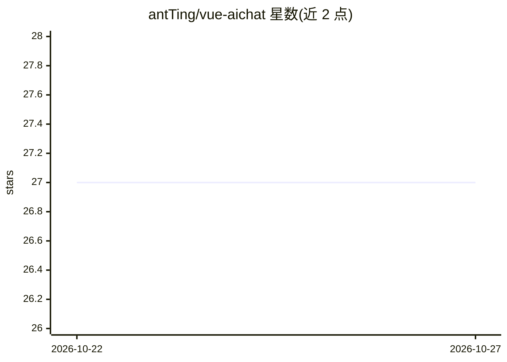

# antTing/vue-aichat

⭐ 27 · TypeScript · 推送 2026-10-21 · [GitHub](https://github.com/antTing/vue-aichat) · 个人维护 · 中文 README

**Vue3 编写的仿 ChatGPT/DeepSeek 网页聊天前端**

基于 Vue 3 + Vite + TypeScript 的聊天 Web 前端，界面设计参考 ChatGPT 与 DeepSeek。通过在项目根目录配置 .env 文件写入 API Key 与 Base URL，接入 OpenAI API 接口风格及 DeepSeek 兼容的模型服务。README 自述项目处于早期开发阶段，仍在维护中。安装运行依赖 pnpm 与 Node.js（>=20.16.0），提供开发热重载、生产构建与 ESLint 命令。

## 筛选速览

| 维度 | 判定 | 备注 |
|---|---|---|
| AI 角色 | `ai-native` | 本体是模型或模型工具 |
| 许可风险 | `none` | — |
| 部署形态 | `library` | 以包/库形式分发 |
| 模型依赖 | locked-api |  |
| 硬件要求 | — | 无带数字的原话,不猜 |
| 安装摩擦 | `low` | 无编译、无系统依赖或容器化 |
| 成熟度 | `idea` | |

## 能力要点

- 兼容 OpenAI API 接口风格与 DeepSeek 模型
- Vue 3 + Vite + TypeScript 技术栈
- 通过 .env 配置 API Key 与 Base URL

## 适用场景

- 快速搭建一个可对接 OpenAI 风格 API 的聊天网页
- 作为 Vue3 聊天前端的学习或二次开发起点

## 场景标签

`聊天机器人` · 领域:对话与助手

## 证据(README 行号)

> L3: vue3仿 chatgpt/deepseek web，兼容deepseek/OpenAI API接口风格的模型。在根目录下手动添加 .env 文件，配置API Key。（如下所示）
> L7: A chat application based on Vue 3, inspired by the design of ChatGPT and DeepSeek. It supports the use of OpenAI API

## 星数曲线

2026-10-22 27 → 2026-10-27 27（+0）

---
*卡片 v1 · prompt 1.4 · 生成 2026-10-26 · 置信度 high · 依据 README sha `2d82e933ea7b` · [字段定义](../../DATASET.md)*
