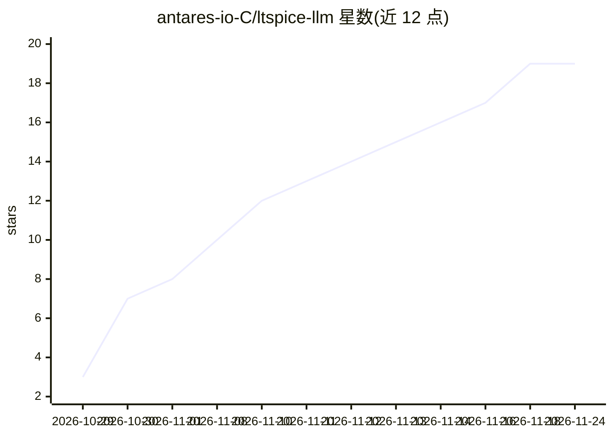

# antares-io-C/ltspice-llm

⭐ 19 · Python · GPL-3.0 · 推送 2026-11-20 · [GitHub](https://github.com/antares-io-C/ltspice-llm) · 个人维护 · 中文 README

**让语言模型与 Python 无界面驱动 LTspice 仿真的工具库**

Python 库，封装 Analog Devices 的 LTspice 电路仿真器：后台无界面运行仿真，解析 .meas 测量、工作点与错误，把波形压缩为 JSON 摘要（min/max/mean/RMS 与 15 点趋势）。提供 OpenAI/Anthropic/Gemini 格式的 10 个工具 schema 与 Agent 循环（AutonomousCircuitAgent），模型可搭建电路、仿真、读数并改值；库本身不连接任何模型服务商。另含规格校验（带保护带）、环路稳定性裕量、KiCad 走线寄生提取、电路 diff、HTML 报告、幻灯片与 GIF 生成等。需 Windows、Python 3.10+ 与另行安装的 LTspice；macOS/Linux 未测试。工具描述与文档为土耳其语。

## 筛选速览

| 维度 | 判定 | 备注 |
|---|---|---|
| AI 角色 | `ai-ecosystem` | LLM/agent 周边工具 |
| 许可风险 | `viral` | GPL-3.0 |
| 部署形态 | `desktop` | 安装包/桌面程序 |
| 模型依赖 | locked-api |  |
| 硬件要求 | — | 无带数字的原话,不猜 |
| 安装摩擦 | `low` | 无编译、无系统依赖或容器化 |
| 成熟度 | — | 结构信号不足 |

## 能力要点

- LTspice 无界面仿真，.meas/工作点/波形输出为 JSON 摘要
- OpenAI/Anthropic/Gemini 格式 10 个工具 schema 与 Agent 循环
- 规格校验（PASS/FAIL/UNVERIFIED、JCGM 106 保护带）与环路稳定裕量分析
- KiCad .kicad_pcb 走线提取 R/L/C 寄生模型（无需安装 KiCad）

## 适用场景

- 让 LLM 通过函数调用自动搭建、仿真并调整电路
- Python 脚本或 CI 中做参数扫描、并行仿真与闭环调参
- 用模型对仿真结果做规格校验并生成 HTML 报告或幻灯片

## 场景标签

`Agent 框架` · 领域:Agent 开发

## 证据(README 行号)

> L11: ready-made tool schemas a model can build a circuit, simulate it, read the numbers and change values; the library
> L26: - **Give a model LTspice as tools.** 10 tool schemas in OpenAI, Anthropic, Gemini or generic format;
> L144: If you would rather not write the loop yourself, `AutonomousCircuitAgent` calls your model, runs the tools it asks

## 星数曲线

2026-10-29 3 → 2026-11-24 19（+16）

---
*卡片 v1 · prompt 1.4 · 生成 2026-11-18 · 置信度 mid · 依据 README sha `4009c8369cde` · [字段定义](../../DATASET.md)*
