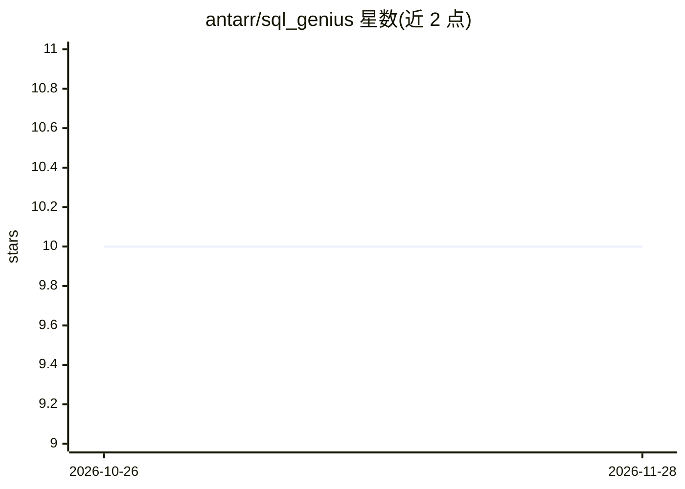

# antarr/sql_genius

⭐ 10 · Ruby · NOASSERTION · 推送 2026-09-23 · [GitHub](https://github.com/antarr/sql_genius) · 个人维护

**Rails 应用的 AI 驱动 SQL 仪表盘，用于巡检优化 MySQL/PostgreSQL**

以 Rails gem 形式安装的数据库巡检面板：读取 performance_schema 与 pg_stat_statements 展示慢查询、开销查询、服务器健康、表大小与索引状况，提供只读 SQL 执行（拦截表、掩码列、行限、超时）与 EXPLAIN 分析。可选 AI 功能含 9 类工具：自然语言生成查询、查询优化、schema 审查、索引顾问、异常检测、根因分析、迁移风险评估，支持 OpenAI/Azure/Ollama 等 OpenAI 兼容端点。非 OSI 开源许可，商用需书面许可。

## 筛选速览

| 维度 | 判定 | 备注 |
|---|---|---|
| AI 角色 | `ai-enhanced` | 去掉 AI 部分产品仍成立 |
| 许可风险 | `none` | NOASSERTION |
| 部署形态 | `None` |  |
| 模型依赖 | local-ok | 支持本地模型 |
| 硬件要求 | — | 无带数字的原话,不猜 |
| 安装摩擦 | `low` | 无编译、无系统依赖或容器化 |
| 成熟度 | — | 结构信号不足 |

## 能力要点

- 9 类 AI 工具：查询生成、优化建议、索引顾问、异常检测、根因分析等
- 安全 SQL 执行：只读强制、拦截表、掩码列、行限、超时
- 慢查询捕获基于 ActiveSupport 通知与 Redis
- 重复/未用索引检测并生成 DROP 语句

## 适用场景

- 为 Rails 应用巡检 MySQL/PostgreSQL 慢查询与服务器健康
- 检测冗余与未用索引并执行清理
- 通过自然语言描述生成 SQL 查询

## 场景标签

`数据分析` · 领域:效率与自动化

## 证据(README 行号)

> L3: An AI-powered SQL dashboard for Rails to help you inspect and optimize MySQL, MariaDB, and PostgreSQL databases.
> L56: - **9 AI Tools** -- suggestions, optimization, schema review, query rewrite, index advisor, anomaly detection, root
> L94: Works with OpenAI, Azure OpenAI, Ollama Cloud, local Ollama, or any OpenAI-compatible API.

## 星数曲线

2026-10-26 10 → 2026-11-28 10（+0）

---
*卡片 v1 · prompt 1.4 · 生成 2026-11-20 · 置信度 high · 依据 README sha `97c22471be31` · [字段定义](../../DATASET.md)*
