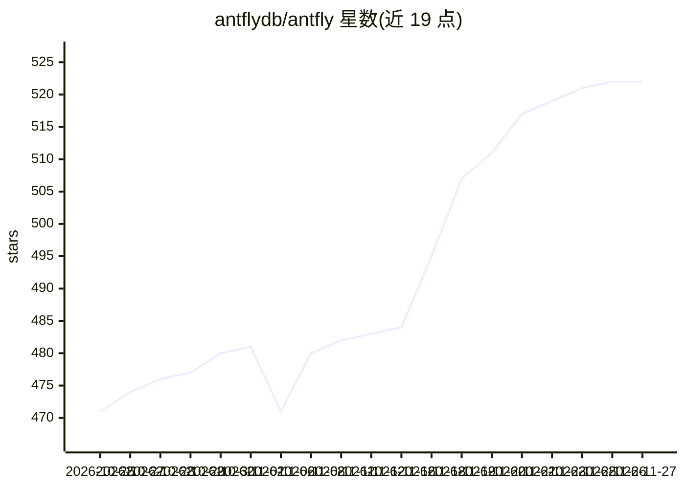

# antflydb/antfly

⭐ 522 · Zig · Apache-2.0 · 推送 2026-11-26 · [GitHub](https://github.com/antflydb/antfly) · [官网](https://antfly.io) · 组织维护

**开源搜索与推理数据库：全文+向量+图索引与内置推理/RAG**

用 Zig 编写的开源搜索与推理数据库，单引擎在同一表上承载 BM25 全文、稠密/稀疏向量索引与图遍历，写数据时自动生成嵌入、分块、实体与图边。分块、嵌入、重排、转录、OCR、抽取等模型推理在进程内运行，并内置带流式输出、多轮对话与工具调用的 RAG agent。部署形态包括单文件 `.aflite`、单节点热备、multi-Raft 集群与对象存储上的 serverless（进行中）。提供 CLI、多语言 SDK/嵌入绑定、Postgres 扩展与 React 组件，Antfly Cloud 为托管选项。

## 筛选速览

| 维度 | 判定 | 备注 |
|---|---|---|
| AI 角色 | `ai-ecosystem` | LLM/agent 周边工具 |
| 许可风险 | `permissive` | Apache-2.0 |
| 部署形态 | `self-host` | docker 或自建部署 |
| 模型依赖 | local-ok | 支持本地模型 |
| 硬件要求 | — | 无带数字的原话,不猜 |
| 安装摩擦 | `low` | 无编译、无系统依赖或容器化 |
| 成熟度 | — | 结构信号不足 |

## 能力要点

- 混合检索：BM25+稠密向量（RaBitQ 压缩）+稀疏向量（SPLADE）一次查询融合
- 内置 RAG agent 与自然语言转结构化查询的 query-builder agent
- 多模态索引检索图像/音频/视频，重排支持 ColBERT/ColQwen2
- 嵌入绑定（C API、Go/Python/Rust/TypeScript、浏览器 WASM）与 Postgres 线协议/SQL

## 适用场景

- 自建带引用与流式回答的 RAG 问答站点
- 混合全文与向量检索的应用搜索
- 从 Postgres 表 CDC 镜像并构建知识图谱
- 本地进程内嵌入数据库与推理（含 WASM 边缘运行）

## 场景标签

`知识图谱` `RAG` `语义搜索` `向量数据库` · 领域:知识与检索

## 证据(README 行号)

> L3: Antfly is an open-source search-and-inference database written in Zig. One engine carries full-text (BM25), dense, a
> L87: - **Bring your own models** — Ollama, OpenAI, OpenRouter, Cohere, Bedrock, Gemini, Vertex AI, or run models locally
> L141: Antfly inference handles the ML side: embeddings, chunking, reranking, classification, NER, OCR, transcription, ge

## 星数曲线

2026-10-25 471 → 2026-11-27 522（+51）

---
*卡片 v1 · prompt 1.4 · 生成 2026-11-25 · 置信度 high · 依据 README sha `19f18c380b8f` · [字段定义](../../DATASET.md)*
