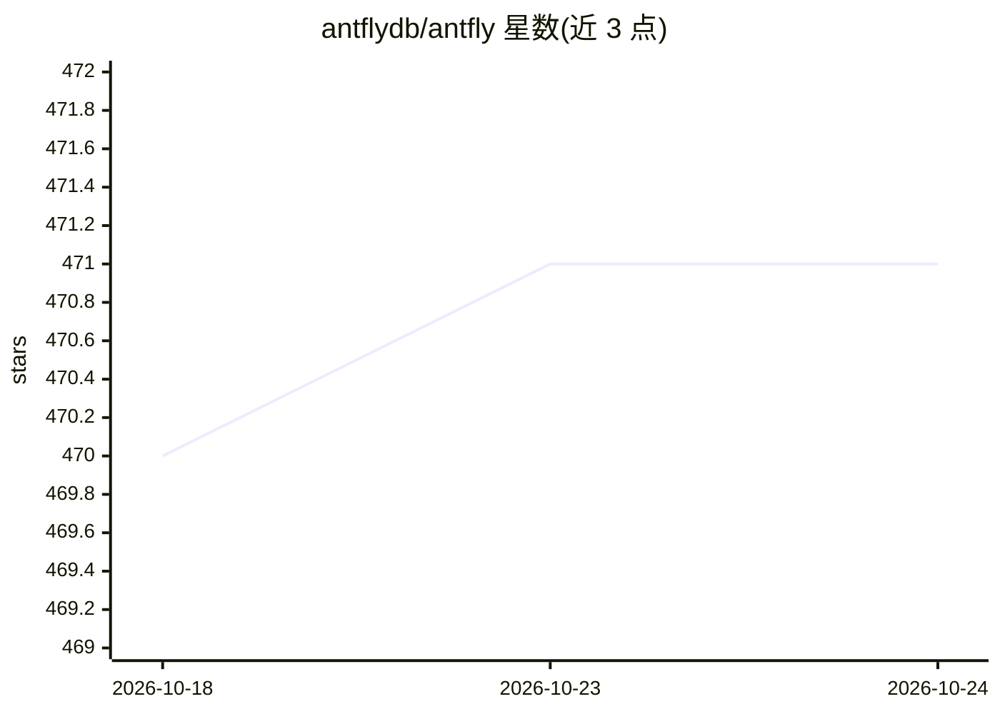

# antflydb/antfly

⭐ 471 · Zig · Apache-2.0 · 推送 2026-10-24 · [GitHub](https://github.com/antflydb/antfly) · [官网](https://antfly.io) · 组织维护

**Zig 编写的检索与推理数据库：混合搜索+RAG+内置推理一体**

Antfly 是用 Zig 实现的搜索与推理数据库：同一张表上承载 BM25 全文、稠密与稀疏向量索引及图遍历，分块、嵌入、重排、转录、OCR、抽取等模型在进程内运行，写入数据时自动生成嵌入、分块、实体与图边，并提供内置 RAG agent 与查询构建 agent。形态包括嵌入式 .aflite 文件（C API 与多语言绑定、浏览器 WASM）、单节点/多 Raft 集群与 serverless（进行中）。嵌入式引擎与推理运行为 Apache 2.0，完整数据库服务器为 ELv2；可自带模型（Ollama、OpenAI、Bedrock 等）或用本地推理运行 GGUF/ONNX。支持 CPU SIMD、Apple Metal 与 CUDA 内核，关键分布式协议经 TLA+ 形式化验证。

## 筛选速览

| 维度 | 判定 | 备注 |
|---|---|---|
| AI 角色 | `ai-ecosystem` | LLM/agent 周边工具 |
| 许可风险 | `none` | Apache-2.0 |
| 部署形态 | `None` |  |
| 模型依赖 | local-ok | 支持本地模型 |
| 硬件要求 | — | 无带数字的原话,不猜 |
| 安装摩擦 | `medium` | 含编译或系统依赖之一 |
| 成熟度 | `idea` | |

## 能力要点

- BM25/稠密/稀疏向量混合检索与图遍历在同一表上融合
- 分块/嵌入/重排/OCR/转录等模型进程内运行，写入时自动生成
- 单文件 .aflite、Raft 集群到 serverless 的多形态部署，多语言嵌入绑定与浏览器 WASM
- CPU/Metal/CUDA 原生内核；分布式协议经 TLA+ 形式化规格与模型检验

## 适用场景

- 搭建混合搜索与 RAG 问答的知识底座
- 在应用内嵌单文件 .aflite 数据库实现本地检索与推理
- 把 PostgreSQL 表通过 CDC 或 antfly-postgres 扩展接入搜索

## 场景标签

`RAG` `语义搜索` `向量数据库` · 领域:知识与检索

## 证据(README 行号)

> L3: Antfly is a search-and-inference database written in Zig. One engine carries full-text (BM25), dense, and sparse vec
> L136: Antfly inference handles the ML side: embeddings, chunking, reranking, classification, NER, OCR, transcription, ge
> L80: - **Bring your own models** — Ollama, OpenAI, OpenRouter, Cohere, Bedrock, Gemini, Vertex AI, or run models locally

## 星数曲线

2026-10-18 470 → 2026-10-24 471（+1）

---
*卡片 v1 · prompt 1.4 · 生成 2026-10-21 · 置信度 high · 依据 README sha `1fb24ce1e5a9` · [字段定义](../../DATASET.md)*
