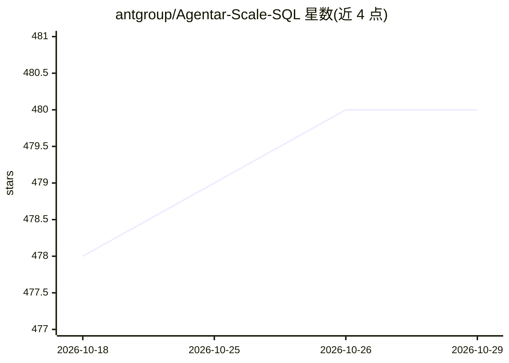

# antgroup/Agentar-Scale-SQL

⭐ 480 · Python · Apache-2.0 · 推送 2026-05-09 · [GitHub](https://github.com/antgroup/Agentar-Scale-SQL) · 组织维护 · 中文 README

**蚂蚁集团的 Text-to-SQL 测试时扩展框架，在 BIRD 榜单达 81.67%**

通过 Orchestrated Test-Time Scaling 策略组合三个视角（ICL 生成器、推理生成器、SQL 选择等模块）生成 SQL，配套 Light Schema Engine 做模式精简、离线预处理管线将训练样例与数据库单元格写入向量库（Chroma，嵌入模型 all-MiniLM-L6-v2），并构建 BM25 索引。已开源 32B 生成模型（Hugging Face/ModelScope）与部分模块代码，任务理解、迭代精炼、SQL 选择等模块尚未发布。安装需 conda 环境、PyTorch（CUDA 12.1）、vLLM 与 Java 环境。文末附 ChatBI 产品 Data Agent 的官网链接。

## 筛选速览

| 维度 | 判定 | 备注 |
|---|---|---|
| AI 角色 | `ai-native` | 本体是模型或模型工具 |
| 许可风险 | `permissive` | Apache-2.0 |
| 部署形态 | `library` | 以包/库形式分发 |
| 模型依赖 | local-ok | 支持本地模型 |
| 硬件要求 | — | 无带数字的原话,不猜 |
| 安装摩擦 | `medium` | 含编译或系统依赖之一 |
| 成熟度 | — | 结构信号不足 |

## 能力要点

- 三视角组合的测试时扩展生成 SQL 候选
- Light Schema Engine 生成轻量模式
- 预处理管线将训练样例与单元格值写入 Chroma 向量库并构建 BM25 索引
- 已发布 Agentar-Scale-SQL-Generation-32B 模型（Hugging Face/ModelScope）

## 适用场景

- 在 BIRD 等 Text-to-SQL 基准上运行评测流程
- 研究生成-选择多视角的 Text-to-SQL 方法
- 基于已开源的 Light Schema Engine 与预处理管线构建自己的流水线

## 场景标签

`数据分析` · 领域:效率与自动化

## 证据(README 行号)

> L10: **Agentar-Scale-SQL** is a novel framework that leverages scalable computation to significantly improve Text-to-SQL
> L26: |**Agentar-Scale-SQL (Ours)**|**74.90**|**81.67**|**77.00**|

## 星数曲线

2026-10-18 478 → 2026-10-29 480（+2）

---
*卡片 v1 · prompt 1.4 · 生成 2026-10-22 · 置信度 mid · 依据 README sha `99da20d44432` · [字段定义](../../DATASET.md)*
