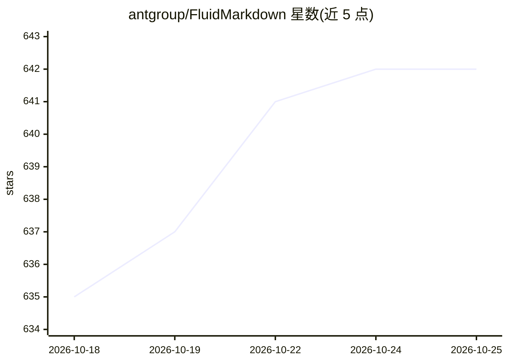

# antgroup/FluidMarkdown

⭐ 642 · JavaScript · Apache-2.0 · 推送 2026-01-30 · [GitHub](https://github.com/antgroup/FluidMarkdown) · 组织维护 · 中文 README

**面向 Android/iOS/HarmonyOS 的流式 Markdown 渲染库**

为原生 Android、iOS 与 HarmonyOS 开发者提供的客户端 Markdown 渲染库，用于 AI 对话场景中大模型生成内容的流式渐进渲染。基于 CommonMark 解析库（Android 侧基于 Markwon），支持标题、列表、表格、代码块、数学公式等语法及若干 HTML 标签，提供流式与一次性渲染两种模式，流式速度可通过参数调节，样式以结构化模型暴露以便定制，并支持点击事件、可见性回调等。HarmonyOS 最低 API 版本为 15，表格内交互与嵌套 HTML 存在已知限制，HarmonyOS 的 LaTeX 尚在开发中。

## 筛选速览

| 维度 | 判定 | 备注 |
|---|---|---|
| AI 角色 | `ai-ecosystem` | LLM/agent 周边工具 |
| 许可风险 | `permissive` | Apache-2.0 |
| 部署形态 | `None` |  |
| 模型依赖 | — | README 未给出锁定关系 |
| 硬件要求 | — | 无带数字的原话,不猜 |
| 安装摩擦 | `low` | 无编译、无系统依赖或容器化 |
| 成熟度 | — | 结构信号不足 |

## 能力要点

- 流式渐进渲染与一次性全量渲染两种模式
- 支持表格、数学公式、代码块、脚notes 等 Markdown 语法及部分 HTML 标签
- 样式以结构化模型暴露，支持自定义与主题配置
- 流式速度可调，提供点击处理与渲染状态等事件回调

## 适用场景

- AI 聊天应用中流式展示大模型生成的 Markdown 内容
- 在自有 App 中定制 Markdown 渲染样式与主题
- HarmonyOS 应用中集成带打字机效果的富文本渲染

## 场景标签

 · 领域:移动端 UI 组件/文档渲染

## 证据(README 行号)

> L2: We are committed to enabling the streaming rendering of Markdown content generated by large language models on the c
> L5: This library is designed for native Android, iOS and HarmonyOS developers. Built on the open-source CommonMark parsi

## 星数曲线

2026-10-18 635 → 2026-10-25 642（+7）

---
*卡片 v1 · prompt 1.4 · 生成 2026-10-21 · 置信度 high · 依据 README sha `826cc9339f1d` · [字段定义](../../DATASET.md)*
