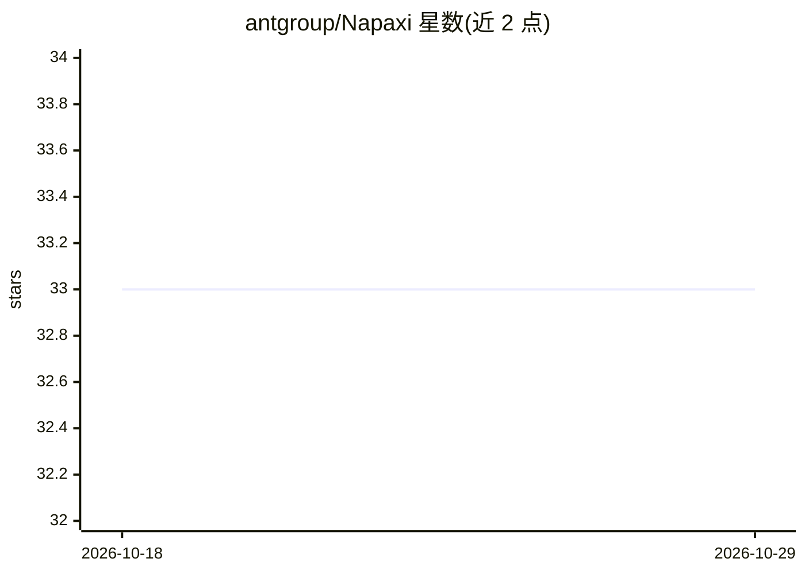

# antgroup/Napaxi

⭐ 33 · Rust · GPL-3.0 · 推送 2026-10-23 · [GitHub](https://github.com/antgroup/Napaxi) · 组织维护 · 中文 README

**移动端原生 agent SDK：在 App 内嵌入端上 AI 代理运行时**

面向移动应用团队的 agent 开发 SDK：以共享 Rust agent 运行时为核心，提供 Flutter（首个完整适配）、Android、iOS 薄适配层与示例应用。运行时承载会话、工作区状态、存储、工具、技能、MCP、平台钩子与后台执行；本地工具执行隔离在移动沙箱、策略门与宿主授权之后，除 App 批准的模型调用外不依赖云服务器。支持 14+ 内置工具、多模型编排、自定义工具，及 xApp/xAgent/xChannel 跨应用、跨代理、跨渠道连接。宿主 App 保留 UI、账号、模型配置与产品策略；SDK 不附带产品 UI。

## 筛选速览

| 维度 | 判定 | 备注 |
|---|---|---|
| AI 角色 | `ai-ecosystem` | LLM/agent 周边工具 |
| 许可风险 | `viral` | GPL-3.0 |
| 部署形态 | `None` |  |
| 模型依赖 | — | README 未给出锁定关系 |
| 硬件要求 | — | 无带数字的原话,不猜 |
| 安装摩擦 | `low` | 无编译、无系统依赖或容器化 |
| 成熟度 | — | 结构信号不足 |

## 能力要点

- Rust 共享运行时 + Flutter/Android/iOS 薄适配层架构
- 端上执行：除 App 批准的模型调用外不依赖云端服务器
- 移动沙箱、策略门与宿主授权隔离本地工具执行
- 14+ 移动优先内置工具、MCP 工具、多模型编排与自定义工具
- xApp/xAgent/xChannel 连接应用、代理与设备渠道

## 适用场景

- 在自有移动 App 中嵌入可使用文件、工具与技能的 agent
- 构建端上多代理协作或跨应用交互的 agent 应用
- 通过宿主批准的通道连接智能家居、蓝牙设备等外部设备
- 从手机本地完成 App 代码生成、构建 APK 并安装回设备

## 场景标签

`Agent 框架` `多智能体` · 领域:Agent 开发

## 证据(README 行号)

> L16: Napaxi is a mobile-native SDK for embedding agent experiences in your app.
> L18: It gives app teams a shared Rust agent runtime, thin mobile SDK adapters, and a
> L21: reusable runtime pieces: sessions, workspace state, storage, tools, skills,

## 星数曲线

2026-10-18 33 → 2026-10-29 33（+0）

---
*卡片 v1 · prompt 1.4 · 生成 2026-10-25 · 置信度 high · 依据 README sha `9a7ff23437ec` · [字段定义](../../DATASET.md)*
