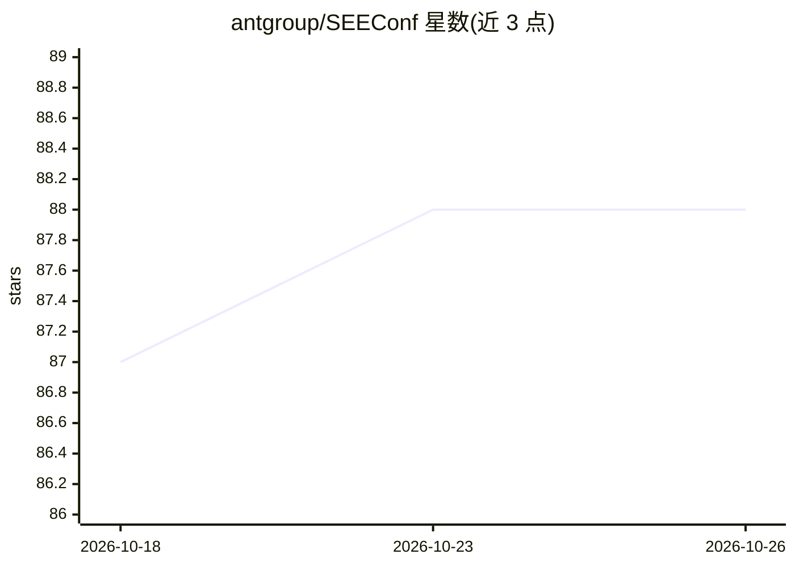

# antgroup/SEEConf

⭐ 88 · 推送 2025-12-01 · [GitHub](https://github.com/antgroup/SEEConf) · [官网](https://seeconf.antgroup.com) · 组织维护 · 中文 README

**蚂蚁举办的用户体验与工程实践技术大会（官网仓库）**

蚂蚁集团终端技术委员会举办的 SEE Conf（支付宝体验科技大会）的官方仓库，内容为会议介绍与历年（2018-2022、2025）官网和语雀资料链接。大会包含专业分享、产品展台、Workshop 等形式，面向业界分享体验科技进展。仓库本身不提供可安装的软件、代码或数据集，仅作为会议信息入口。

## 筛选速览

| 维度 | 判定 | 备注 |
|---|---|---|
| AI 角色 | `ai-knowledge` | 知识聚合/清单类 |
| 许可风险 | `none` | — |
| 部署形态 | `None` |  |
| 模型依赖 | — | README 未给出锁定关系 |
| 硬件要求 | — | 无带数字的原话,不猜 |
| 安装摩擦 | `low` | 无编译、无系统依赖或容器化 |
| 成熟度 | — | 结构信号不足 |

## 能力要点

- 由蚂蚁终端技术委员会举办的技术大会
- 收录 2018-2022、2025 六届官网与语雀资料链接
- 内容涵盖专业分享、产品展台、Workshop

## 适用场景

- 查找历届 SEE Conf 大会的官网与资料入口
- 了解蚂蚁体验科技大会的定位与内容形式

## 场景标签

 · 领域:技术大会/用户体验

## 证据(README 行号)

> L4: <ins>SEE Conf = Seeking Experience & Engineering</ins>，意为探索用户体验与工程实践，由蚂蚁终端技术委员会举办，包括专业分享、产品展台、Workshop 等内容。我们希望通过 SE
> L10: |官网|2018 · 2019 · 2020 · 2021 · 2022 · 2025|

## 星数曲线

2026-10-18 87 → 2026-10-26 88（+1）

---
*卡片 v1 · prompt 1.4 · 生成 2026-10-23 · 置信度 mid · 依据 README sha `98a2641e0047` · [字段定义](../../DATASET.md)*
