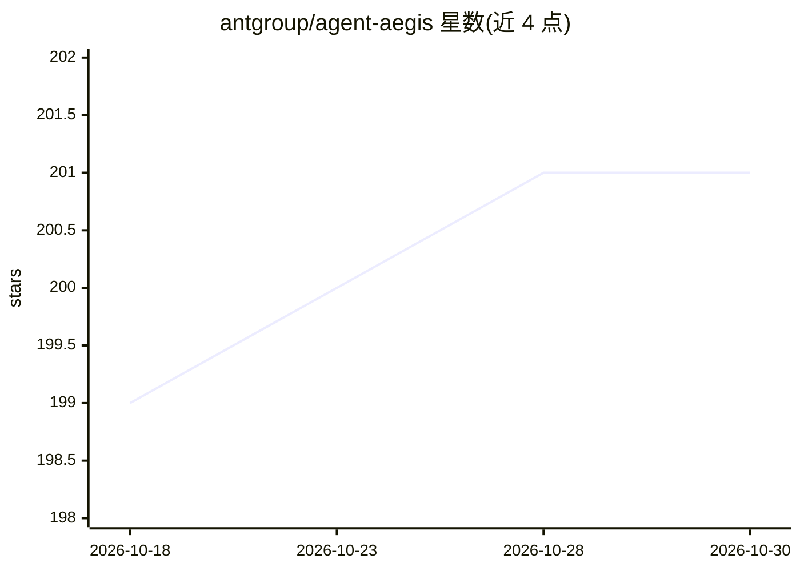

# antgroup/agent-aegis

⭐ 201 · TypeScript · Apache-2.0 · 推送 2026-07-14 · [GitHub](https://github.com/antgroup/agent-aegis) · 组织维护 · 中文 README

**OpenClaw agent 的五层纵深运行时安全防护插件**

蚂蚁集团开源的 OpenClaw 轻量内置安全插件，在九个生命周期钩子上构建基础扫描、感知输入、认知状态、决策对齐、执行控制五层防御，覆盖技能投毒、记忆污染、意图偏离、恶意执行与资源耗尽等风险。提供技能扫描、工具调用治理、工具结果检查、输出脱敏等内置防御，各防御可按 enforce/observe/off 分级配置；含独立 WebUI 管理面板（本地绑定 127.0.0.1、令牌鉴权），面向安全运营者与个人用户。通过 git clone 加 openclaw plugins install 安装，WebUI 需 npm 构建运行。

## 筛选速览

| 维度 | 判定 | 备注 |
|---|---|---|
| AI 角色 | `ai-ecosystem` | LLM/agent 周边工具 |
| 许可风险 | `permissive` | Apache-2.0 |
| 部署形态 | `library` | 以包/库形式分发 |
| 模型依赖 | — | README 未给出锁定关系 |
| 硬件要求 | — | 无带数字的原话,不猜 |
| 安装摩擦 | `low` | 无编译、无系统依赖或容器化 |
| 成熟度 | — | 结构信号不足 |

## 能力要点

- 五层纵深防御覆盖 OpenClaw 九个生命周期钩子
- 技能投毒扫描、记忆污染防护、工具调用治理、SSRF/外泄链拦截
- 每项防御支持 enforce/observe/off 三级模式与受保护路径/技能/插件配置
- 自带 WebUI 管理面板：状态矩阵、事件日志、可信技能列表

## 适用场景

- 为本地运行的 OpenClaw agent 增加运行时安全防护
- 通过 observe 模式灰度观察风险事件后再升级为拦截
- 保护敏感文件与高价值技能/插件不被篡改删除

## 场景标签

`网络安全` · 领域:学习与行业

## 证据(README 行号)

> L7: > AgentAegis builds a multi-dimensional, defense-in-depth runtime security architecture for OpenClaw-style agents, i
> L22: Through this layered, progressive mechanism, AgentAegis ensures that OpenClaw possesses fine-grained risk mitigatio
> L62: - **Five-Layer Defense-in-Depth** — Covers intent scanning, tool call governance, tool result inspection, asset pro

## 星数曲线

2026-10-18 199 → 2026-10-30 201（+2）

---
*卡片 v1 · prompt 1.4 · 生成 2026-10-22 · 置信度 high · 依据 README sha `7f5646d2535e` · [字段定义](../../DATASET.md)*
