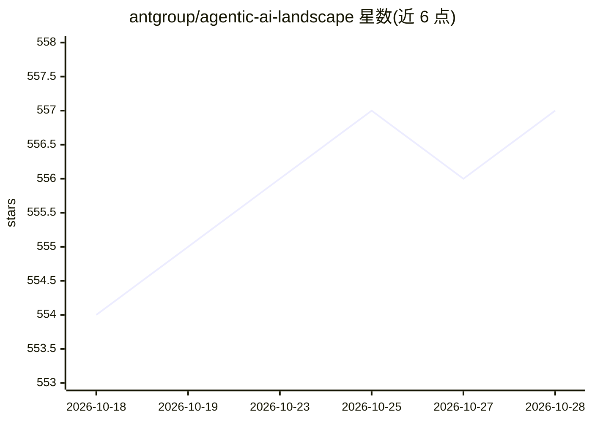

# antgroup/agentic-ai-landscape

⭐ 557 · HTML · 推送 2026-09-27 · [GitHub](https://github.com/antgroup/agentic-ai-landscape) · [官网](https://insights.inclusion-ai.org/) · 组织维护 · 中文 README

**数据驱动的 Agentic AI 生态全景图与洞察报告（蚂蚁开源）**

由 Ant Open Source 与 inclusionAI 维护的 Agentic AI 生态编目仓库：以 CSV 数据集（按 GitHub repo_id 组织，含 stars/license/OpenRank 等元数据与人工策展字段）收录各生态层代表性项目，分为 Agent Infra 与 Model Infra 两大板块；配套 Next.js 全景网站（npm run web:dev 本地预览）、双语 landscape 报告、案例研究、周报自动生成脚本（Python venv + GitHub/ClickHouse 凭据）与基于 OpenRank 的项目活力度量。面向关注 agent 生态选型与趋势的开发者和研究者。

## 筛选速览

| 维度 | 判定 | 备注 |
|---|---|---|
| AI 角色 | `ai-knowledge` | 知识聚合/清单类 |
| 许可风险 | `none` | — |
| 部署形态 | `library` | 以包/库形式分发 |
| 模型依赖 | — | README 未给出锁定关系 |
| 硬件要求 | — | 无带数字的原话,不猜 |
| 安装摩擦 | `low` | 无编译、无系统依赖或容器化 |
| 成熟度 | — | 结构信号不足 |

## 能力要点

- 以 GitHub repo_id 为键的规范化项目数据集，含策展字段（layer/selection_reason/caveat）
- 用 OpenRank 而非 star 数度量项目活力，纳入 issue/PR/review/贡献者活动
- Next.js 全景网站本地预览，CSV 与站点改动自动重建
- 周报脚本自动生成新浮现项目的快照

## 适用场景

- 了解 Agentic AI 各生态层的代表性开源项目
- 基于 CSV 数据集做自己的生态分析或排名
- 跟踪每周新浮现的 agent 生态项目

## 场景标签

`精选清单` · 领域:学习与行业

## 证据(README 行号)

> L10: The 2026 landscape maps two infrastructure blocks: **Agent Infra** organizes the application, framework, runtime, a
> L26: The canonical dataset is `data/agentic-ai-projects.csv`. Each row is keyed by the GitHub `repo_id`, carries GitHub 

## 星数曲线

2026-10-18 554 → 2026-10-28 557（+3）

---
*卡片 v1 · prompt 1.4 · 生成 2026-10-23 · 置信度 mid · 依据 README sha `1e9c90d18eee` · [字段定义](../../DATASET.md)*
