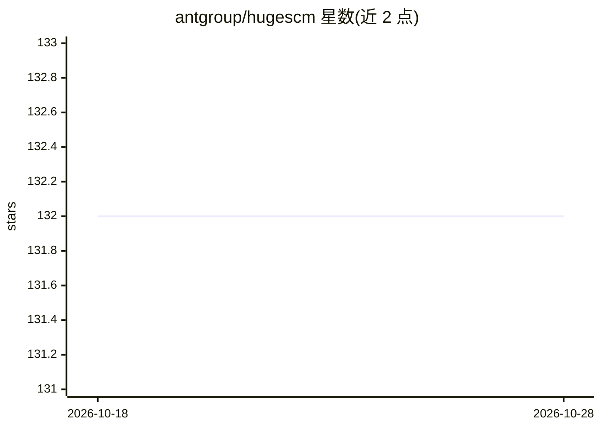

# antgroup/hugescm

⭐ 132 · Go · Apache-2.0 · 推送 2026-10-19 · [GitHub](https://github.com/antgroup/hugescm) · 组织维护 · 中文 README

**面向大型仓库与 AI 模型开发的云端版本控制系统**

云原生集中式版本控制系统（客户端命令 zeta），将元数据存于分布式数据库、文件内容存于对象存储，用内置 Fragments 与 CDC 内容定义分块处理大文件（如数十至数百 GB 的模型 checkpoint、游戏资源、数据集）。命令集仿 Git（add/commit/pull/switch/stash），支持按需 checkout、稀疏检出、单文件检出、dragonfly/aria2 下载加速，并提供 zeta-mc 从 Git 迁移、hot 工具维护 Git 仓库。需安装 Golang 用 bali 工具从源码构建。

## 筛选速览

| 维度 | 判定 | 备注 |
|---|---|---|
| AI 角色 | `ai-enhanced` | 去掉 AI 部分产品仍成立 |
| 许可风险 | `permissive` | Apache-2.0 |
| 部署形态 | `self-host` | docker 或自建部署 |
| 模型依赖 | — | README 未给出锁定关系 |
| 硬件要求 | — | 无带数字的原话,不猜 |
| 安装摩擦 | `low` | 无编译、无系统依赖或容器化 |
| 成熟度 | — | 结构信号不足 |

## 能力要点

- 元数据（DB）与文件内容（对象存储）分离存储
- Fragments 与 CDC 内容定义分块，支持大文件去重与增量同步
- 按需/稀疏/单文件/逐文件检出，降低大仓库磁盘占用
- zeta-mc 支持 Git 仓库迁移，hot 命令维护 Git 仓库

## 适用场景

- 管理 AI 模型 checkpoint 与大规模数据集的版本
- 游戏美术资源等大型二进制文件的版本控制与团队协作
- 从 Git 迁移超大 monorepo 并按需检出目录

## 场景标签

 · 领域:开发工具/版本控制

## 证据(README 行号)

> L13: HugeSCM (codename zeta) is a cloud-native version control system designed for large-scale repositories. By separati
> L24: ### AI Model Development
> L26: - Store checkpoint files (tens to hundreds of GB)

## 星数曲线

2026-10-18 132 → 2026-10-28 132（+0）

---
*卡片 v1 · prompt 1.4 · 生成 2026-10-22 · 置信度 mid · 依据 README sha `22bcd21a2223` · [字段定义](../../DATASET.md)*
