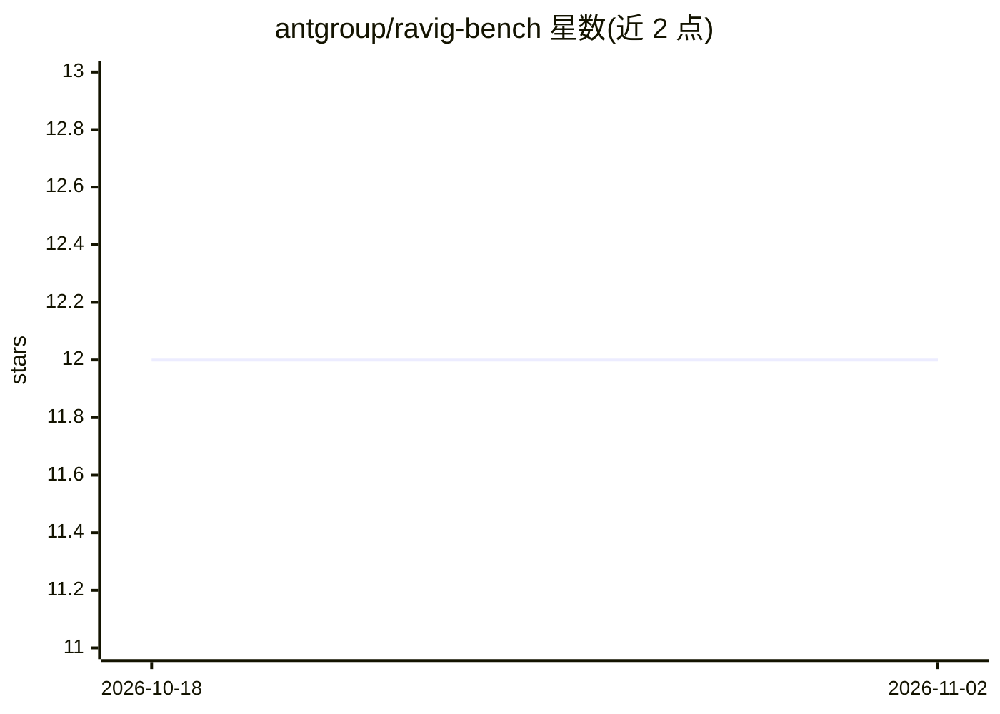

# antgroup/ravig-bench

⭐ 12 · Python · Apache-2.0 · 推送 2026-04-09 · [GitHub](https://github.com/antgroup/ravig-bench) · 组织维护 · 中文 README

**富视觉生成（RAViG）系统的多模态自动化评测基准**

论文 RAViG-Bench 的官方实现：评测"检索增强富视觉生成"系统——即基于检索参考文档生成含视觉设计的 HTML/CSS 代码的模型。评测框架覆盖三个维度：HTML 执行正确性校验、基于自动截图分析与启发式检查的设计质量评估、基于 LLM 提示的内容质量评估。面向研究者与开发者，以 Bash 脚本运行端到端评测管线，结果输出为结构化 JSON 报告；运行前需配置 LLM 服务 API key，并在 Selenium 截图场景下安装浏览器驱动。提供 demo 脚本用于验证安装。

## 筛选速览

| 维度 | 判定 | 备注 |
|---|---|---|
| AI 角色 | `ai-ecosystem` | LLM/agent 周边工具 |
| 许可风险 | `permissive` | Apache-2.0 |
| 部署形态 | `library` | 以包/库形式分发 |
| 模型依赖 | — | README 未给出锁定关系 |
| 硬件要求 | — | 无带数字的原话,不猜 |
| 安装摩擦 | `low` | 无编译、无系统依赖或容器化 |
| 成熟度 | — | 结构信号不足 |

## 能力要点

- 三维度评测：执行正确性、设计质量、内容质量
- 自动截图分析与启发式检查评估视觉设计
- LLM-based 提示评估内容质量
- 内置示例数据的 demo 评测脚本

## 适用场景

- 对自己模型生成的 HTML 输出跑完整评测管线
- 验证评测安装与查看输出格式的 demo 运行
- 多维度对比不同富视觉生成系统的表现

## 场景标签

`模型评测` · 领域:评测与运维

## 证据(README 行号)

> L7: RAViG-Bench is a comprehensive benchmark for evaluating **Retrieval-Augmented Visually-rich Generation (RAViG)** sys
> L11: - **Multi-dimensional Evaluation**: Assesses models across three critical dimensions:

## 星数曲线

2026-10-18 12 → 2026-11-02 12（+0）

---
*卡片 v1 · prompt 1.4 · 生成 2026-11-01 · 置信度 high · 依据 README sha `b3b5c1b6b29b` · [字段定义](../../DATASET.md)*
