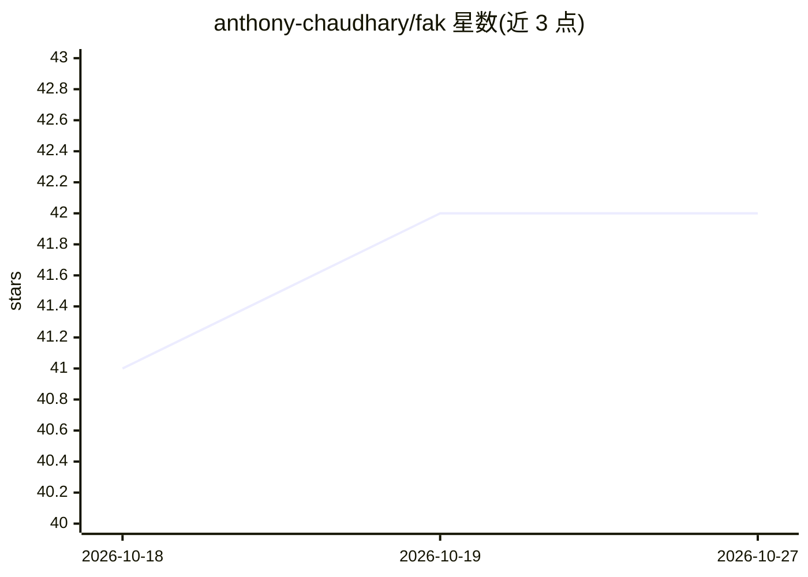

# anthony-chaudhary/fak

⭐ 42 · Go · Apache-2.0 · 推送 2026-10-26 · [GitHub](https://github.com/anthony-chaudhary/fak) · [官网](https://anthony-chaudhary.github.io/fak/showcase.html) · 个人维护

**面向开发者的本地 agentic 运行时：原生推理、KV 缓存与 agent 治理**

用 Go 编写的本地 agent 运行时：在 Apple Silicon Mac 上启动原生推理（OpenAI 兼容端点 :8080），按内存自动分配模型与上下文，支持多 agent 会话的连续批处理与预填充共享、agentic KV 缓存复用等加速机制。可接入 OpenCode、Codex、Claude Code、Pi 等 agent；`fak guard` 为外部 agent 提供默认拒绝的能力下限（capability floor）与工具调用治理，`fak agent --offline` 可无模型离线运行。README 明确标注多项功能（speculative decoding、GPU Direct 路径）尚未默认开启或普遍验证，并提供各平台性能数据与声明边界文档。Apache-2.0 许可。

## 筛选速览

| 维度 | 判定 | 备注 |
|---|---|---|
| AI 角色 | `ai-ecosystem` | LLM/agent 周边工具 |
| 许可风险 | `permissive` | Apache-2.0 |
| 部署形态 | `library` | 以包/库形式分发 |
| 模型依赖 | — | README 未给出锁定关系 |
| 硬件要求 | — | 无带数字的原话,不猜 |
| 安装摩擦 | `medium` | 含编译或系统依赖之一 |
| 成熟度 | `idea` | |

## 能力要点

- 原生推理引擎：自动按内存分配模型/上下文，内存压力下回退而非换页
- agentic KV 缓存复用工作进度，多会话共享 prefill 与连续批处理
- fak guard 为 Claude Code / Codex 等外部 agent 加默认拒绝的工具能力下限
- 离线模式 `fak agent --offline` 无模型无 GPU 可运行

## 适用场景

- 在自己的 Mac 上运行本地 agent 并保持跨轮上下文
- 给已在用的 Claude Code / Codex 包一层工具调用治理
- 查阅各硬件平台（Mac/AMD/NVIDIA）的推理性能数据与声明边界

## 场景标签

`推理引擎` `Agent 框架` · 领域:Agent 开发

## 证据(README 行号)

> L8: Our first milestone combines native inference, speculative decoding, and reuse of
> L50: Already running Claude Code or Codex? Wrap the agent you already run with one command

## 星数曲线

2026-10-18 41 → 2026-10-27 42（+1）

---
*卡片 v1 · prompt 1.4 · 生成 2026-10-25 · 置信度 high · 依据 README sha `a427d5341c32` · [字段定义](../../DATASET.md)*
