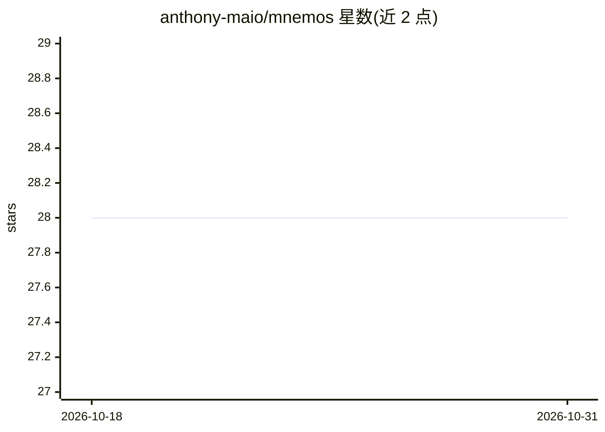

# anthony-maio/mnemos

⭐ 28 · Python · MIT · 推送 2026-10-28 · [GitHub](https://github.com/anthony-maio/mnemos) · [官网](https://mnemos.making-minds.ai) · 个人维护

**给编程 agent 的本地分层记忆层（MCP）**

面向编程 agent 的 local-first 记忆层，通过 MCP 接入 Claude Code、Claude Desktop、Cursor、Codex 等宿主。将项目、工作区与全局上下文分层存储在本地 SQLite，检索时可解释（mnemos inspect 说明记忆为何被召回），并提供反馈记录与导出。底层含五个仿生模块：SurprisalGate 预测误差门控、MutableRAG 记忆再巩固（覆写过期事实）、AffectiveRouter 情绪路由、SleepDaemon 睡眠巩固与 SpreadingActivation 图检索。可选 Ollama/OpenAI 后端，v1 非托管/团队产品。

## 筛选速览

| 维度 | 判定 | 备注 |
|---|---|---|
| AI 角色 | `ai-ecosystem` | LLM/agent 周边工具 |
| 许可风险 | `permissive` | MIT |
| 部署形态 | `library` | 以包/库形式分发 |
| 模型依赖 | local-ok | 支持本地模型 |
| 硬件要求 | — | 无带数字的原话,不猜 |
| 安装摩擦 | `low` | 无编译、无系统依赖或容器化 |
| 成熟度 | `idea` | |

## 能力要点

- repo/workspace/global 三层作用域记忆，本地 SQLite 持久化
- MCP 服务器接入 Claude Code、Cursor、Codex 等宿主
- 五个仿生模块（惊异门控、再巩固、情绪路由、睡眠巩固、扩散激活）可独立或组合使用
- 检索可解释（inspect 说明召回原因）+ CLI 反馈记录与 JSONL 导出

## 适用场景

- 让编程 agent 在跨会话中保留仓库约定与环境约束等记忆
- 避免记忆无限追加，自动改写过期事实
- 为 MCP 宿主提供可检查、分层的作用域记忆

## 场景标签

`Agent 记忆` · 领域:Agent 开发

## 证据(README 行号)

> L5:  Local-first memory for coding agents that keeps project, workspace, and global context separate.
> L21: Mnemos is a local-first memory layer for coding agents. The v1 target is straightforward:
> L263: mnemos ships a full Model Context Protocol server. Any MCP-compatible agent can call Mnemos tools natively, with t

## 星数曲线

2026-10-18 28 → 2026-10-31 28（+0）

---
*卡片 v1 · prompt 1.4 · 生成 2026-10-26 · 置信度 high · 依据 README sha `117d7c4ec167` · [字段定义](../../DATASET.md)*
