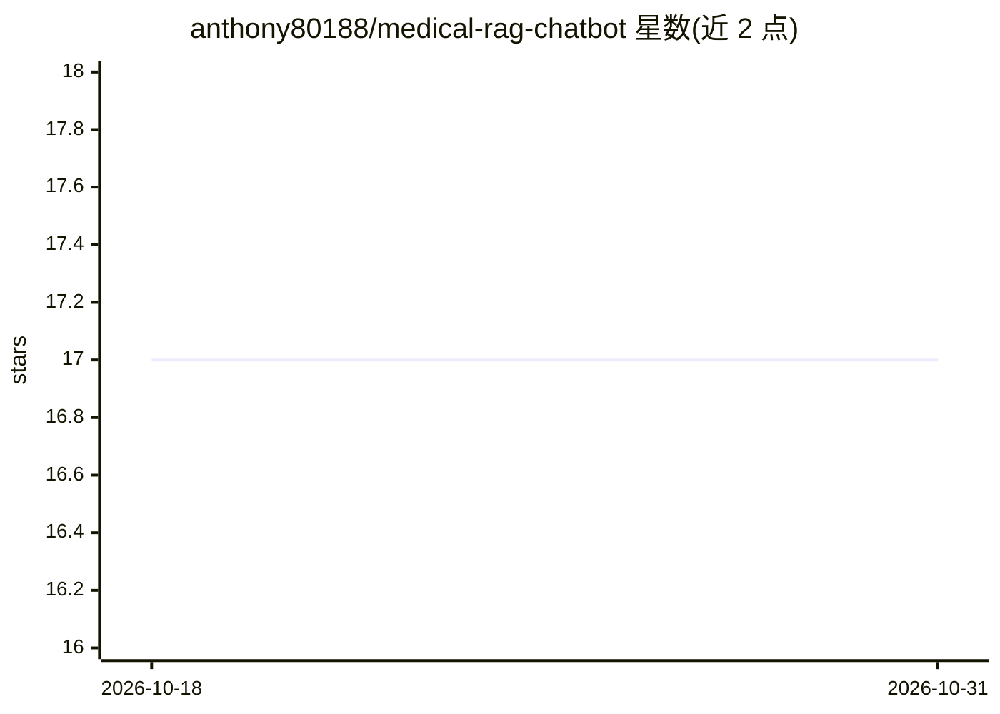

# anthony80188/medical-rag-chatbot

⭐ 17 · TypeScript · MIT · 推送 2026-06-06 · [GitHub](https://github.com/anthony80188/medical-rag-chatbot) · [官网](https://medquad.netlify.app/) · 个人维护

**基于 RAG 的医疗 FAQ 聊天机器人（FastAPI+React）**

面向医疗问答场景的全栈聊天机器人：后端用 Python/FastAPI，通过 LangChain 处理查询，在 Qdrant 向量库上对 MedQuAD 数据集做语义检索，调用 OpenAI API 生成回答；前端为 React + Radix-UI + Vite。提示词要求回答简洁（不超过 5 句）、未知时明确说不确定。后端用 poetry 安装依赖并运行 FastAPI 服务，前端用 pnpm 安装并启动。README 提供截图演示，仓库 docs 目录含更多图片与视频。

## 筛选速览

| 维度 | 判定 | 备注 |
|---|---|---|
| AI 角色 | `ai-native` | 本体是模型或模型工具 |
| 许可风险 | `permissive` | MIT |
| 部署形态 | `library` | 以包/库形式分发 |
| 模型依赖 | — | README 未给出锁定关系 |
| 硬件要求 | — | 无带数字的原话,不猜 |
| 安装摩擦 | `low` | 无编译、无系统依赖或容器化 |
| 成熟度 | — | 结构信号不足 |

## 能力要点

- Qdrant 向量检索 MedQuAD 医疗问答数据集
- LangChain 查询处理与上下文检索
- FastAPI 后端 + React 前端全栈结构
- 提示词限定回答简短并允许拒答

## 适用场景

- 医疗常见问题的问答查询
- 搭建基于 RAG 的垂直领域 FAQ 机器人示例
- 参考前后端分离的 LLM 应用工程结构

## 场景标签

`聊天机器人` `RAG` · 领域:对话与助手

## 证据(README 行号)

> L5: - Retrieval-Augmented Generation (RAG): Combines vector-based retrieval with LLMs to generate accurate, context-awar
> L6: - Optimized Vector Search with Qdrant: Enables fast and accurate semantic search across the MedQuAD dataset.

## 星数曲线

2026-10-18 17 → 2026-10-31 17（+0）

---
*卡片 v1 · prompt 1.4 · 生成 2026-10-29 · 置信度 high · 依据 README sha `aa1f55f71f94` · [字段定义](../../DATASET.md)*
