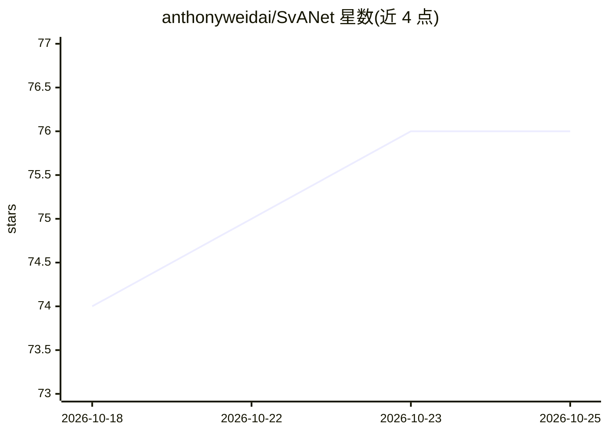

# anthonyweidai/SvANet

⭐ 76 · Python · MIT · 推送 2026-10-11 · [GitHub](https://github.com/anthonyweidai/SvANet) · 组织维护

**医学小目标分割网络 SvANet 的官方 PyTorch 实现**

论文 Exploiting Scale-Variant Attention for Segmenting Small Medical Objects（IEEE TNNLS 2026）的官方代码实现，提出尺度可变注意力机制用于医学图像中微小目标的语义分割。仓库提供训练、评测与推理流程：通过 main.sh 配置训练与评估，需从 torchvision 下载预训练模型，推理评估使用 tinyObjectsValidation.py；另含消融实验脚本（ablation.sh / ablation_extra.sh）与训练可视化、日志、指标计算功能。安装步骤见 INSTALL.md，数据准备见 DATA.md。面向复现论文结果或在其方法上做研究的科研人员。

## 筛选速览

| 维度 | 判定 | 备注 |
|---|---|---|
| AI 角色 | `ai-native` | 本体是模型或模型工具 |
| 许可风险 | `permissive` | MIT |
| 部署形态 | `None` |  |
| 模型依赖 | — | README 未给出锁定关系 |
| 硬件要求 | — | 无带数字的原话,不猜 |
| 安装摩擦 | `low` | 无编译、无系统依赖或容器化 |
| 成熟度 | — | 结构信号不足 |

## 能力要点

- 尺度可变注意力机制用于微小医学目标分割
- 提供 main.sh 训练/评测与 ablation.sh 消融实验脚本
- 推理评估使用 tinyObjectsValidation.py
- 支持训练进度可视化、日志与标准指标计算

## 适用场景

- 在医学影像数据集上复现论文分割结果
- 对小目标分割方法做消融与对比实验
- 基于 SvANet 结构开展后续研究改进

## 场景标签

`目标检测` · 领域:感知与多模态

## 证据(README 行号)

> L1: # Exploiting Scale-Variant Attention for Segmenting Small Medical Objects
> L6: Accepted in IEEE Transactions on Neural Networks and Learning Systems, 2026. [Paper][arXiv]
> L16: To initiate the training and evaluation processes, utilize the configuration settings provided in the main.sh scrip

## 星数曲线

2026-10-18 74 → 2026-10-25 76（+2）

---
*卡片 v1 · prompt 1.4 · 生成 2026-10-24 · 置信度 high · 依据 README sha `874cbf83e039` · [字段定义](../../DATASET.md)*
