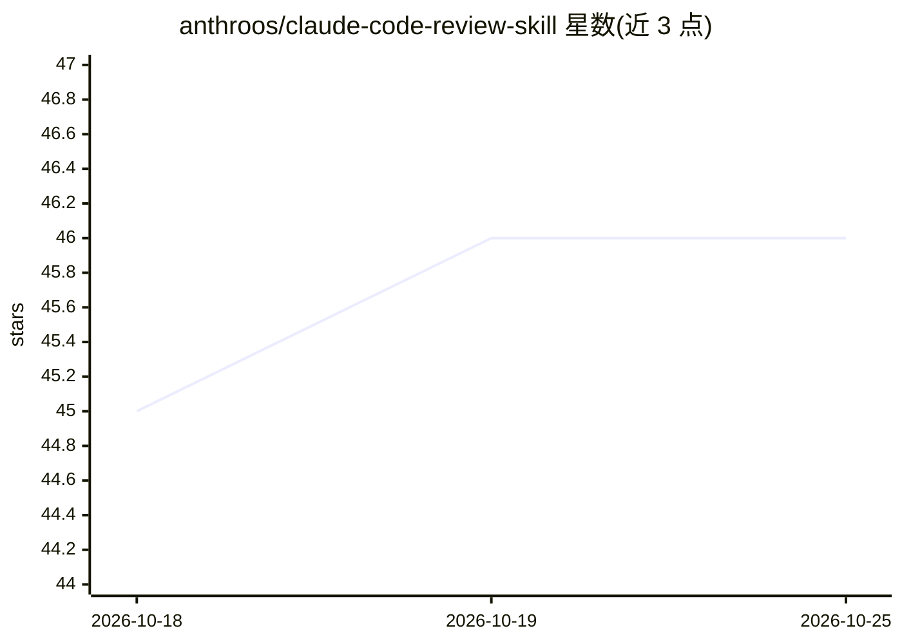

# anthroos/claude-code-review-skill

⭐ 46 · MIT · 推送 2026-02-27 · [GitHub](https://github.com/anthroos/claude-code-review-skill) · 个人维护

**给 Claude Code 的代码审查技能：280+ 检查项的本地免费审查**

面向 Claude Code CLI 用户的代码审查技能（SKILL.md 文件）：通过 curl 下载单个文件安装到项目或全局技能目录后，用自然语言命令（如 claude "review PR 123"）触发自动化审查。覆盖安全（63 项，含 OWASP Top 10）、缺陷、性能、代码质量等 15 类 280+ 检查，支持 React/TypeScript/Python/Node.js 等语言专项规则。机制包括置信度≥70% 才报告、Git blame 跳过既有问题、严重度过滤与行内抑制注释。需自备 Claude Code CLI 与 GitHub CLI，结果可回帖到 GitHub。

## 筛选速览

| 维度 | 判定 | 备注 |
|---|---|---|
| AI 角色 | `ai-ecosystem` | LLM/agent 周边工具 |
| 许可风险 | `permissive` | MIT |
| 部署形态 | `None` |  |
| 模型依赖 | locked-api |  |
| 硬件要求 | — | 无带数字的原话,不猜 |
| 安装摩擦 | `low` | 无编译、无系统依赖或容器化 |
| 成熟度 | — | 结构信号不足 |

## 能力要点

- 280+ 检查项分 15 类，安全类 63 项含 OWASP Top 10
- 置信度评分（≥70% 才报告）与 Git blame 跳过既有问题
- 严重度过滤、focus 模式与 @review-ok 行内抑制
- 支持 pre-push Git 钩子与 GitHub Actions CI/CD 集成

## 适用场景

- 在 Claude Code 里对 PR 做本地、隐私优先的自动代码审查
- 合并前扫描 SQL 注入、硬编码密钥等安全问题
- 定制公司专属审查规则并接入 CI 流水线

## 场景标签

`代码审查` · 领域:编码与开发

## 证据(README 行号)

> L18: A **skill** for Claude Code that enables automated, comprehensive code review with **280+ checks** across 15 catego
> L69: 1. **Claude Code CLI** — Install here

## 星数曲线

2026-10-18 45 → 2026-10-25 46（+1）

---
*卡片 v1 · prompt 1.4 · 生成 2026-10-25 · 置信度 high · 依据 README sha `5cafb6f2cb12` · [字段定义](../../DATASET.md)*
