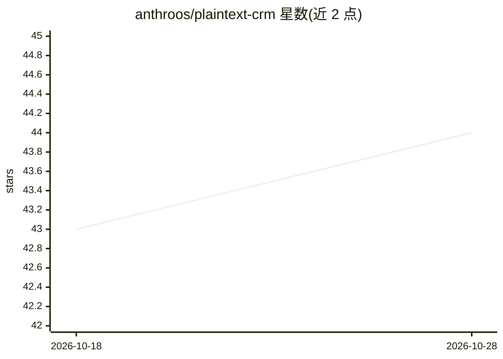

# anthroos/plaintext-crm

⭐ 44 · Python · MIT · 推送 2026-07-02 · [GitHub](https://github.com/anthroos/plaintext-crm) · 个人维护

**在 IDE 中通过对话操作的纯文本 CSV CRM**

以 CSV 文件为数据存储、以 Claude Code 或 Cursor 为操作界面的 CRM 系统：用户用自然语言让 AI 完成 contacts、leads、deals、activities 的增查改，AI 读取 CLAUDE.md 中的 schema 与规则执行操作。提供 schema.yaml 与 validate_csv.py 做数据校验（必填字段、外键、枚举、CSV 注入防护），支持 Git 版本控制与离线使用。集成 Telegram、Gmail、WhatsApp、LinkedIn 等渠道，面向 solo founders 与 1-5 人小团队。需 Python 3.10+ 与 pandas/pyyaml。

## 筛选速览

| 维度 | 判定 | 备注 |
|---|---|---|
| AI 角色 | `ai-native` | 本体是模型或模型工具 |
| 许可风险 | `permissive` | MIT |
| 部署形态 | `library` | 以包/库形式分发 |
| 模型依赖 | — | README 未给出锁定关系 |
| 硬件要求 | — | 无带数字的原话,不猜 |
| 安装摩擦 | `low` | 无编译、无系统依赖或容器化 |
| 成熟度 | — | 结构信号不足 |

## 能力要点

- 自然语言驱动 contacts/leads/deals/activities 全流程操作
- schema.yaml + validate_csv.py 数据校验与 CSV 注入防护
- CSV 文件存储，Git 版本控制，可离线运行
- Telegram/Gmail/WhatsApp/LinkedIn/HeyReach 等渠道集成

## 适用场景

- 独立创始人不离开 IDE 就管理销售线索和客户
- 小团队用对话替代 CRM 界面记录跟进与交易
- 用 Git 管控并校验自有 CRM 数据

## 场景标签

 · 领域:业务软件/CRM

## 证据(README 行号)

> L8: **AI-native CRM that runs in your IDE.** No SaaS, no dashboards -- just talk to your sales data.
> L37: That's it. The AI reads `CLAUDE.md` and understands the full CRM schema, validation rules, and available operations

## 星数曲线

2026-10-18 43 → 2026-10-28 44（+1）

---
*卡片 v1 · prompt 1.4 · 生成 2026-10-25 · 置信度 mid · 依据 README sha `a04a647380da` · [字段定义](../../DATASET.md)*
