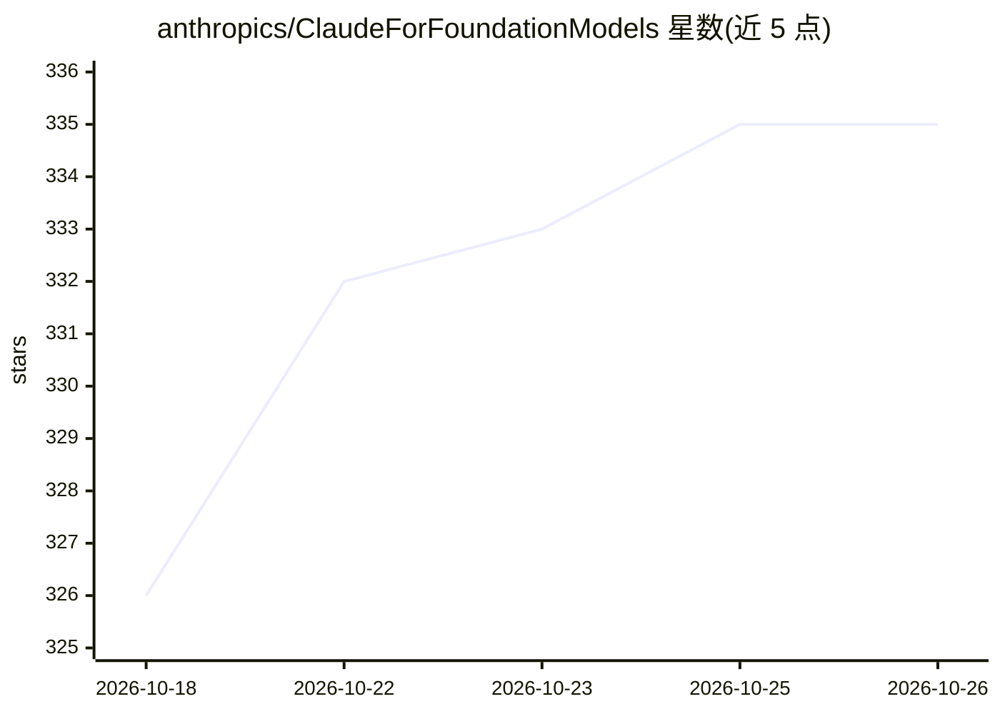

# anthropics/ClaudeForFoundationModels

⭐ 335 · Swift · Apache-2.0 · 推送 2026-10-07 · [GitHub](https://github.com/anthropics/ClaudeForFoundationModels) · 组织维护

**将 Claude 接入 Apple Foundation Models 框架的 Swift 适配包**

Anthropic 官方维护的 Swift 包，把 Claude 包装为符合 Apple Foundation Models `LanguageModel` 协议的服务端语言模型，开发者用统一的 `LanguageModelSession` API（respond(to:)、流式、guided generation、工具调用）驱动 Claude。支持模型能力声明、effort 级别固定、最多三个 fallback 模型自动接力、服务端工具（web search/fetch/代码执行）、@Generable 结构化输出。认证走 App Attest 或 API key，支持按用户 profile 归因计费。面向 Apple 平台开发者（需 iOS/macOS 27 beta、Xcode 27）。声明为 Beta，API 可能变动；非通用 Anthropic Messages API 客户端。

## 筛选速览

| 维度 | 判定 | 备注 |
|---|---|---|
| AI 角色 | `ai-ecosystem` | LLM/agent 周边工具 |
| 许可风险 | `permissive` | Apache-2.0 |
| 部署形态 | `None` |  |
| 模型依赖 | locked-api |  |
| 硬件要求 | — | 无带数字的原话,不猜 |
| 安装摩擦 | `low` | 无编译、无系统依赖或容器化 |
| 成熟度 | `idea` | |

## 能力要点

- 将 Claude 适配为 Foundation Models `LanguageModel` 协议提供者
- fallback 机制：被策略拒绝的请求自动由备用模型接力完成
- App Attest 设备认证与用户 profile 归因
- 服务端 web search/fetch/代码执行工具及流式内联展示

## 适用场景

- 在 Apple 平台 App 中用统一 Foundation Models API 调用 Claude
- 已用 LanguageModelSession 的代码无侵入切换到 Claude
- 需要拒绝场景自动 fallback 与用户级计费归因的应用

## 场景标签

`模型网关` · 领域:Agent 开发

## 证据(README 行号)

> L3: Use Claude as a server-side language model through Apple's Foundation Models framework. The package conforms Claude 
> L243: ## What this package provides
> L245: The public surface is Apple's Foundation Models provider conformance plus the configuration types that reach it — 

## 星数曲线

2026-10-18 326 → 2026-10-26 335（+9）

---
*卡片 v1 · prompt 1.4 · 生成 2026-10-21 · 置信度 high · 依据 README sha `31b9407606d4` · [字段定义](../../DATASET.md)*
