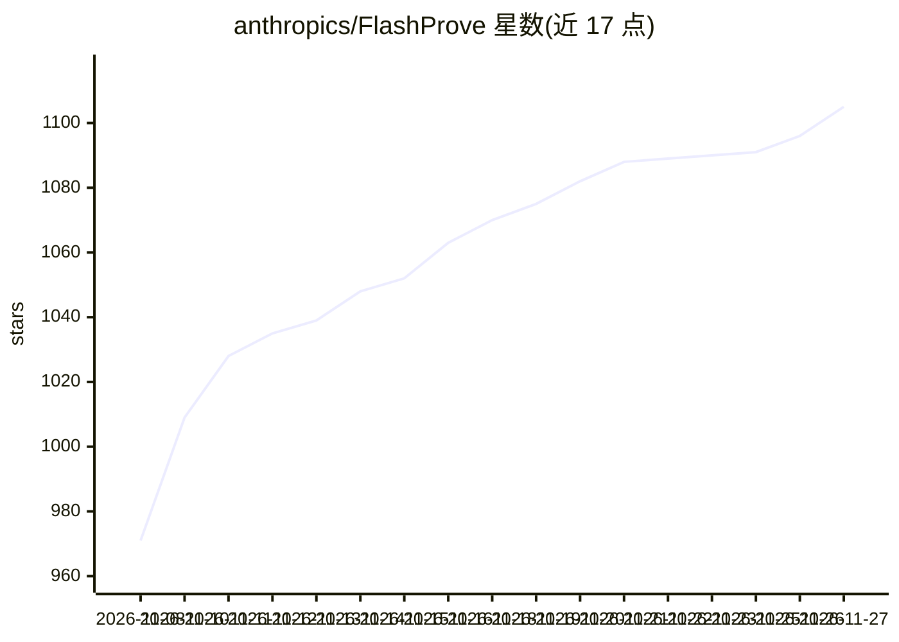

# anthropics/FlashProve

⭐ 1,105 · Lean · Apache-2.0 · 推送 2026-10-30 · [GitHub](https://github.com/anthropics/FlashProve) · 组织维护

**AI 推理零知识证明研究原型：证明回答来自承诺模型**

研究原型，让 AI 提供方在不泄露模型权重的前提下证明某条回答出自其承诺的模型。机制为三步：发布绑定权重的承诺 ID、GPU 生成每条回答的证明、任何人用 cp_verify 在普通 CPU 上数秒验证。运行 Llama 4 Maverick 全尺寸（单张 H100，1024 token 上下文），协议可靠性在 Lean 4 中证明。构建与验证流程设计为由编码 agent 执行。声明不再维护、不接受贡献。

## 筛选速览

| 维度 | 判定 | 备注 |
|---|---|---|
| AI 角色 | `ai-ecosystem` | LLM/agent 周边工具 |
| 许可风险 | `permissive` | Apache-2.0 |
| 部署形态 | `None` |  |
| 模型依赖 | — | README 未给出锁定关系 |
| 硬件要求 | — | 无带数字的原话,不猜 |
| 安装摩擦 | `high` | 编译与系统依赖俱全 |
| 成熟度 | `idea` | |

## 能力要点

- 承诺-证明-验证三步零知识证明协议，验证无需权重
- Llama 4 Maverick 全尺寸在单张 H100 上运行，约 110 tokens/s prefill
- 协议可靠性在 Lean 4 中形式化证明（错误概率约 q/2^124 + 2^-101）
- CPU 端验证在数秒内完成，内存需求低于 2 GB

## 适用场景

- AI 提供方向第三方证明回答确实出自其承诺的模型
- 不接触权重即可核验模型输出真实性
- 研究零知识证明在 AI 推理可验证性上的应用

## 场景标签

 · 领域:密码学/可验证 AI 推理

## 证据(README 行号)

> L7: FlashProve lets an AI provider prove which model answered a request, without revealing the model's
> L13: - **Prove.** For each reply, the provider's GPU produces a proof that the reply is the committed

## 星数曲线

2026-11-08 971 → 2026-11-27 1,105（+134）

---
*卡片 v1 · prompt 1.4 · 生成 2026-11-17 · 置信度 high · 依据 README sha `77e3d6fac98e` · [字段定义](../../DATASET.md)*
