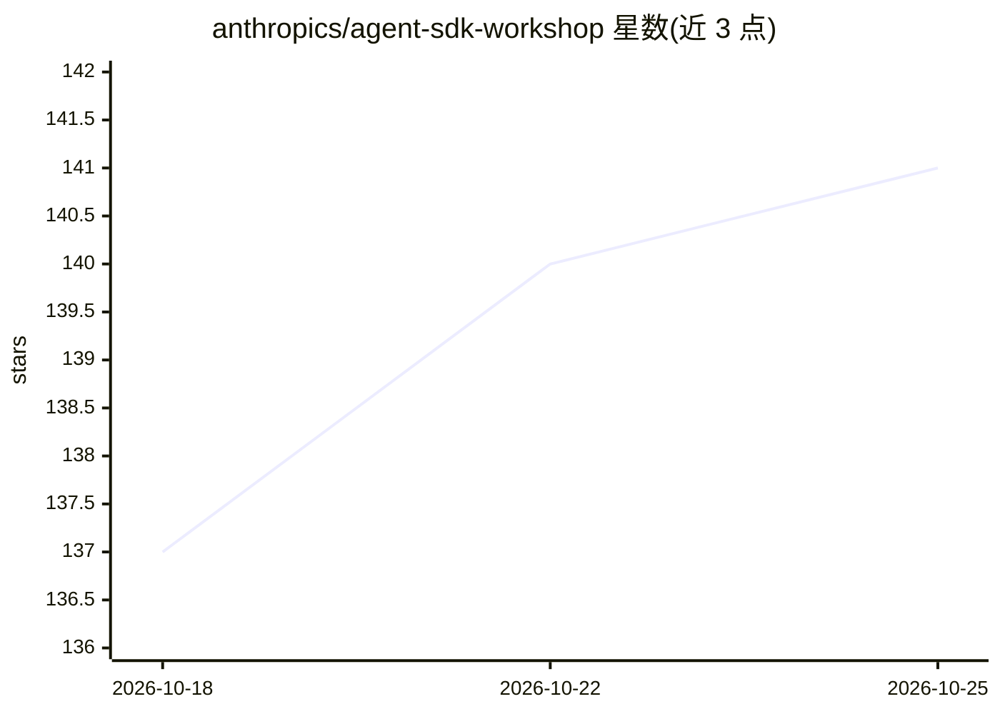

# anthropics/agent-sdk-workshop

⭐ 141 · Python · Apache-2.0 · 推送 2026-03-05 · [GitHub](https://github.com/anthropics/agent-sdk-workshop) · 组织维护

**Claude Agent SDK 实操工作坊：配置拼装生产级 Agent**

面向使用 Claude Agent SDK 构建 Agent 的开发者提供动手教程材料：通过在 config.py 中拨动开关、从预置组件库（6 类 19 个工具、6 个子 Agent）中挑选并撰写提示词来组装 Agent，无需自行编写代码。包含四阶段引导演示（工具、子 Agent、记忆钩子逐级启用）、6 个场景化的 breakout 练习与扩展指南，提供 ./workshop 命令做环境检查与运行。要求 Python 3.10+ 与 Anthropic API key，所有工具由本地 mock 数据支撑，不依赖外部服务。

## 筛选速览

| 维度 | 判定 | 备注 |
|---|---|---|
| AI 角色 | `ai-ecosystem` | LLM/agent 周边工具 |
| 许可风险 | `permissive` | Apache-2.0 |
| 部署形态 | `None` |  |
| 模型依赖 | locked-api |  |
| 硬件要求 | — | 无带数字的原话,不猜 |
| 安装摩擦 | `low` | 无编译、无系统依赖或容器化 |
| 成熟度 | — | 结构信号不足 |

## 能力要点

- 四阶段引导演示：依次启用 tools、subagents、memory 观察 Agent 表现变化
- 预置组件库：6 类 19 个工具与 6 个子 Agent 可自由拼装
- ./workshop 单一入口命令负责检查环境与运行各环节
- 全部工具由本地 mock 数据支撑，无需额外凭证或外部服务

## 适用场景

- 跟着阶段化演示学习 Claude Agent SDK 的核心原语
- 挑选客服、SRE、客户情报等场景练习组装 Agent
- 作为团队内部 Agent 开发培训教材

## 场景标签

`教程课程` · 领域:学习与行业

## 证据(README 行号)

> L3: Hands-on workshop materials for building production agents with the Claude Agent SDK.
> L5: **No code writing required.** You flip switches, pick from component lists, and write prompts. The SDK does the rest

## 星数曲线

2026-10-18 137 → 2026-10-25 141（+4）

---
*卡片 v1 · prompt 1.4 · 生成 2026-10-22 · 置信度 high · 依据 README sha `13133bd2ac04` · [字段定义](../../DATASET.md)*
