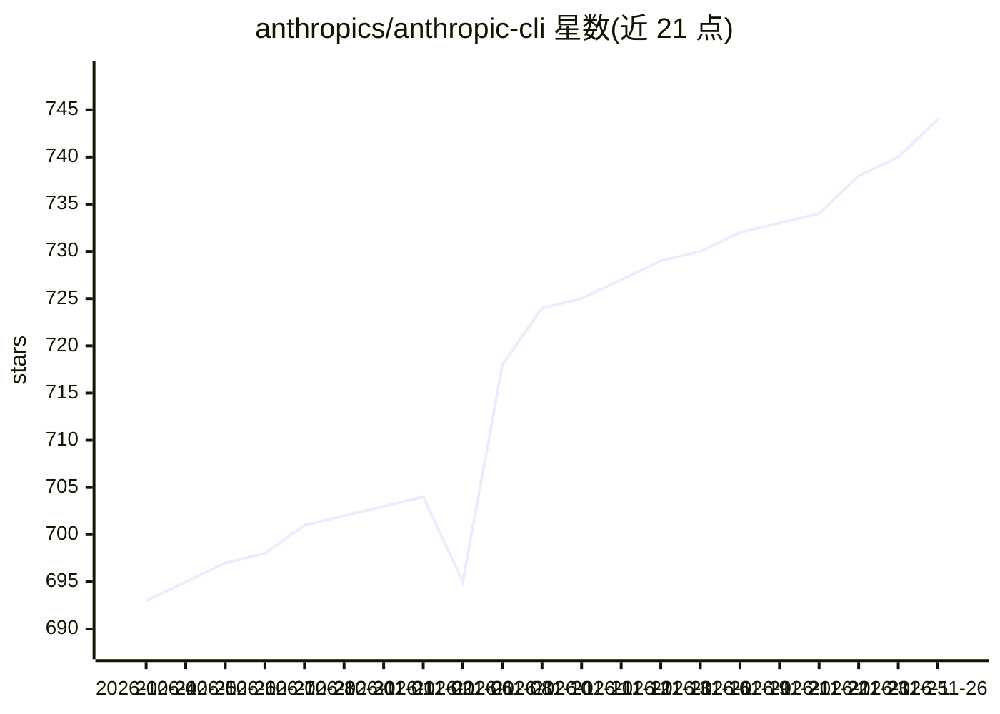

# anthropics/anthropic-cli

⭐ 744 · Go · Apache-2.0 · 推送 2026-11-24 · [GitHub](https://github.com/anthropics/anthropic-cli) · [官网](https://platform.claude.com/docs/en/api/sdks/cli) · 组织维护

**面向开发者的 Claude API 官方命令行客户端**

ant 是 Claude Platform 的官方 CLI，把 Claude API 接入终端：发送消息、管理 agent 与会话、上传文件，并可脚本化调用各 API 端点。支持三种接入途径：API key/Claude Console 登录、Google Cloud 网关（自动刷新 Google 令牌）、AWS 网关（AWS 凭证签名）以及 Microsoft Foundry 资源。结构化 flag 接受宽松 JSON/YAML。通过 Homebrew 或 go install 安装，需 Go 1.22+ 源码构建，运行于 macOS/Linux/Windows。

## 筛选速览

| 维度 | 判定 | 备注 |
|---|---|---|
| AI 角色 | `ai-ecosystem` | LLM/agent 周边工具 |
| 许可风险 | `permissive` | Apache-2.0 |
| 部署形态 | `library` | 以包/库形式分发 |
| 模型依赖 | locked-api |  |
| 硬件要求 | — | 无带数字的原话,不猜 |
| 安装摩擦 | `low` | 无编译、无系统依赖或容器化 |
| 成熟度 | — | 结构信号不足 |

## 能力要点

- 覆盖 Claude API 各端点的终端调用与脚本化
- API key、Google Cloud、AWS、Microsoft Foundry 四类凭证/网关接入
- 密钥可经 stdin 从密码管理器传入，避免写入环境变量
- 结构化参数接受宽松 JSON 或 YAML

## 适用场景

- 在终端和脚本中直接调用 Claude API 发送消息
- 通过企业云网关（GCP/AWS/Foundry）接入 Claude
- 管理 agent、会话与文件上传等平台资源

## 场景标签

 · 领域:LLM 基础设施/API 工具

## 证据(README 行号)

> L6: `ant` is the official CLI for the Claude Platform. It puts the Claude API in your terminal — send messages, manage a
> L16: ### Installing with Homebrew

## 星数曲线

2026-10-24 693 → 2026-11-26 744（+51）

---
*卡片 v1 · prompt 1.4 · 生成 2026-11-24 · 置信度 high · 依据 README sha `2e6eb060964d` · [字段定义](../../DATASET.md)*
