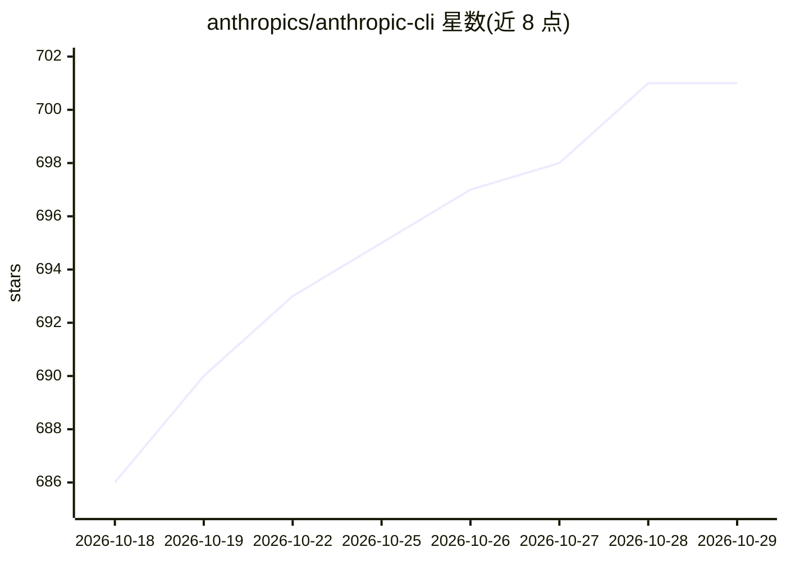

# anthropics/anthropic-cli

⭐ 701 · Go · Apache-2.0 · 推送 2026-10-27 · [GitHub](https://github.com/anthropics/anthropic-cli) · [官网](https://platform.claude.com/docs/en/api/sdks/cli) · 组织维护

**Anthropic 官方 Claude API 命令行客户端 ant**

Anthropic 官方维护的 Claude Platform CLI（命令名 ant），面向使用 Claude API 的开发者：在终端发送消息、管理 agents/sessions/skills/environments/vaults/deployments 等资源，并可脚本化调用每个 API 端点。认证支持 Claude Console 账号登录、ANTHROPIC_API_KEY 环境变量、stdin 传入密钥，也可经 Google Cloud 或 AWS 网关发送请求。提供 ant apply 机制将 agents、skills 等资源以仓库文件形式管理与同步，生成 claude-lock.json 供团队和 CI 复用。安装途径为 Homebrew 或 go install，运行于 macOS/Linux/Windows，MIT 许可。

## 筛选速览

| 维度 | 判定 | 备注 |
|---|---|---|
| AI 角色 | `ai-ecosystem` | LLM/agent 周边工具 |
| 许可风险 | `permissive` | Apache-2.0 |
| 部署形态 | `library` | 以包/库形式分发 |
| 模型依赖 | locked-api |  |
| 硬件要求 | — | 无带数字的原话,不猜 |
| 安装摩擦 | `low` | 无编译、无系统依赖或容器化 |
| 成熟度 | — | 结构信号不足 |

## 能力要点

- 资源式命令结构（ant <resource>:<subresource>），结构化参数接受宽松 JSON/YAML
- ant apply 将 agents/skills/environments/vaults/deployments 以文件形式管理并通过 lockfile 同步
- 支持 Google Cloud 与 AWS 网关路由请求及对应凭证链
- 支持 GitHub Actions 中运行 apply 并提交 lockfile

## 适用场景

- 在终端直接调用 Claude API 发送消息与管理模型列表
- 把 agent/skill 配置纳入代码仓库并通过 CI 部署
- 通过 Google Cloud 或 AWS 网关访问 Claude Platform

## 场景标签

`AI 助手` · 领域:对话与助手

## 证据(README 行号)

> L6: `ant` is the official CLI for the Claude Platform. It puts the Claude API in your terminal — send messages, manage a
> L39: Log in with your Claude Console account:

## 星数曲线

2026-10-18 686 → 2026-10-29 701（+15）

---
*卡片 v1 · prompt 1.4 · 生成 2026-10-21 · 置信度 high · 依据 README sha `c0c068d5b782` · [字段定义](../../DATASET.md)*
