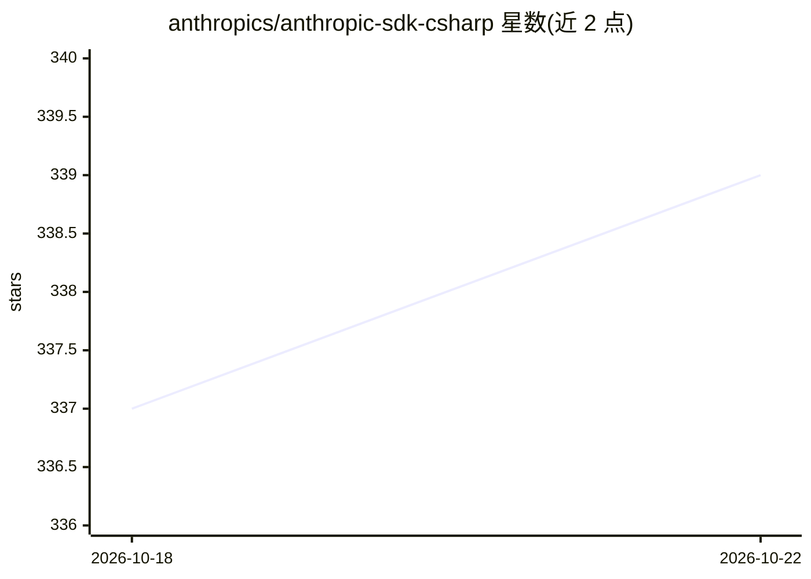

# anthropics/anthropic-sdk-csharp

⭐ 339 · C# · MIT · 推送 2026-10-20 · [GitHub](https://github.com/anthropics/anthropic-sdk-csharp) · 组织维护

**C# 官方 Claude API SDK，供 .NET 应用接入 Claude 模型**

Anthropic 官方维护的 C#/.NET SDK，从 10 版起作为 Claude API 的官方 C# 客户端（此前包名由 tryAGI 社区 SDK 使用，后者已迁移至 tryAGI.Anthropic）。通过 NuGet 分发（dotnet add package Anthropic），提供 Messages API 的类型化调用接口，要求 .NET Standard 2.0+。文档托管于 platform.claude.com。MIT 许可。

## 筛选速览

| 维度 | 判定 | 备注 |
|---|---|---|
| AI 角色 | `ai-ecosystem` | LLM/agent 周边工具 |
| 许可风险 | `permissive` | MIT |
| 部署形态 | `None` |  |
| 模型依赖 | locked-api |  |
| 硬件要求 | — | 无带数字的原话,不猜 |
| 安装摩擦 | `medium` | 含编译或系统依赖之一 |
| 成熟度 | — | 结构信号不足 |

## 能力要点

- Anthropic 官方 C# SDK（版本 10+ 起）
- 通过 NuGet 包 Anthropic 安装
- 要求 .NET Standard 2.0+

## 适用场景

- 在 C#/.NET 应用中调用 Claude Messages API
- 为企业 .NET 服务集成 Claude 模型能力

## 场景标签

 · 领域:LLM 基础设施/API SDK

## 证据(README 行号)

> L8: The Claude SDK for C# provides access to the Claude API from C# applications.
> L17: dotnet add package Anthropic

## 星数曲线

2026-10-18 337 → 2026-10-22 339（+2）

---
*卡片 v1 · prompt 1.4 · 生成 2026-10-21 · 置信度 high · 依据 README sha `3af312faecd3` · [字段定义](../../DATASET.md)*
