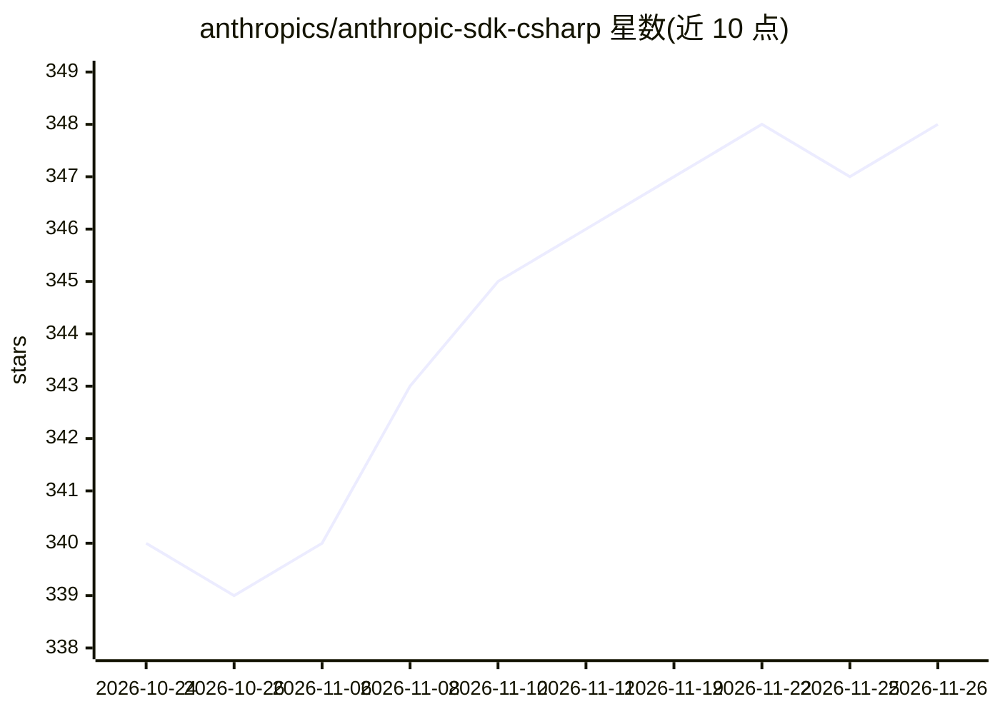

# anthropics/anthropic-sdk-csharp

⭐ 348 · C# · Apache-2.0 · 推送 2026-11-24 · [GitHub](https://github.com/anthropics/anthropic-sdk-csharp) · 组织维护

**供 C# 开发者接入 Claude API 的官方 SDK**

Anthropic 官方维护的 C# SDK，使 .NET 应用可调用 Claude API；通过 NuGet 以 Anthropic 包分发，运行于 .NET Standard 2.0+。README 说明版本 10 起为官方 SDK，此前 3.X 及以下为 tryAGI 社区版，旧客户端需改用 tryAGI.Anthropic 包名。文档在 platform.claude.com 提供，示例代码展示创建客户端并发送 Messages 请求。许可证由 MIT 变更为 Apache 2.0，旧版本仍保留 MIT。

## 筛选速览

| 维度 | 判定 | 备注 |
|---|---|---|
| AI 角色 | `ai-ecosystem` | LLM/agent 周边工具 |
| 许可风险 | `permissive` | Apache-2.0 |
| 部署形态 | `None` |  |
| 模型依赖 | locked-api |  |
| 硬件要求 | — | 无带数字的原话,不猜 |
| 安装摩擦 | `medium` | 含编译或系统依赖之一 |
| 成熟度 | — | 结构信号不足 |

## 能力要点

- 官方 C# SDK，经 NuGet 包 Anthropic 分发（dotnet add package）
- 运行于 .NET Standard 2.0+
- 示例展示 Messages API 调用
- v10+ 与社区版 tryAGI.Anthropic 的包名划分说明

## 适用场景

- 在 C#/.NET 应用中集成 Claude 对话与文本生成能力
- 将原先使用 tryAGI 社区版 SDK 的项目迁移到官方包

## 场景标签

 · 领域:LLM 基础设施/API 客户端

## 证据(README 行号)

> L8: The Anthropic SDK for C# provides access to the Claude API from C# applications.
> L17: dotnet add package Anthropic

## 星数曲线

2026-10-24 340 → 2026-11-26 348（+8）

---
*卡片 v1 · prompt 1.4 · 生成 2026-11-25 · 置信度 high · 依据 README sha `36b335f9cad3` · [字段定义](../../DATASET.md)*
