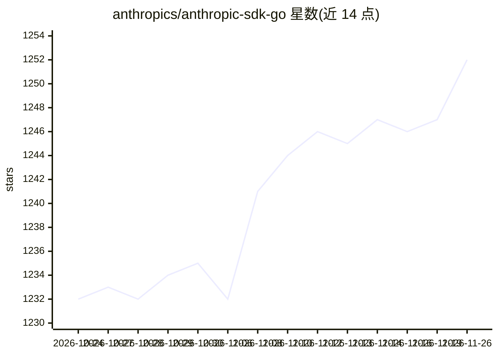

# anthropics/anthropic-sdk-go

⭐ 1,252 · Go · Apache-2.0 · 推送 2026-11-24 · [GitHub](https://github.com/anthropics/anthropic-sdk-go) · 组织维护

**Go 开发者接入 Claude API 的官方 SDK**

Anthropic 官方维护的 Go 语言 SDK，供 Go 应用访问 Claude API。通过 go get 添加依赖或 import 引入，要求 Go 1.25+，README 提供 Getting started 示例代码，完整文档位于 platform.claude.com。采用 Apache License 2.0，且说明早期版本及历史第三方贡献保留 MIT 许可。

## 筛选速览

| 维度 | 判定 | 备注 |
|---|---|---|
| AI 角色 | `ai-ecosystem` | LLM/agent 周边工具 |
| 许可风险 | `permissive` | Apache-2.0 |
| 部署形态 | `None` |  |
| 模型依赖 | locked-api |  |
| 硬件要求 | — | 无带数字的原话,不猜 |
| 安装摩擦 | `low` | 无编译、无系统依赖或容器化 |
| 成熟度 | — | 结构信号不足 |

## 能力要点

- Anthropic 官方 Go SDK，访问 Claude API
- 通过 go get 安装，要求 Go 1.25+
- 提供完整文档入口与入门示例代码
- Apache 2.0 许可，旧版本保留 MIT

## 适用场景

- 在 Go 后端服务中调用 Claude API
- 为 Go 应用添加大模型对话/生成能力

## 场景标签

 · 领域:LLM 基础设施/SDK

## 证据(README 行号)

> L5: The Anthropic SDK for Go provides access to the Claude API from Go applications.
> L22: go get -u 'github.com/anthropics/anthropic-sdk-go/v2@v2.14.0'

## 星数曲线

2026-10-24 1,232 → 2026-11-26 1,252（+20）

---
*卡片 v1 · prompt 1.4 · 生成 2026-11-25 · 置信度 high · 依据 README sha `2701e70f1764` · [字段定义](../../DATASET.md)*
