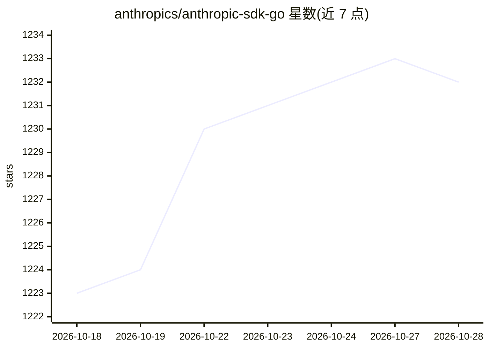

# anthropics/anthropic-sdk-go

⭐ 1,234 · Go · Apache-2.0 · 推送 2026-10-27 · [GitHub](https://github.com/anthropics/anthropic-sdk-go) · 组织维护

**Anthropic 官方 Go SDK：从 Go 应用调用 Claude API**

由 Anthropic 维护的 Go 语言官方 SDK，供开发者在 Go 应用中接入 Claude API，发送请求并处理响应。通过 go get 导入依赖即可使用，提供 NewClient 等客户端构造方式与请求选项（option）机制。内置 OpenTelemetry 支持：注册 tracer provider 后每次 API 调用自动上报为 span，可配置内容记录模式（默认不记录请求/响应内容）、内容字节上限（默认最多 750,000 字节）与传播行为。要求 Go 1.24+，MIT 许可。

## 筛选速览

| 维度 | 判定 | 备注 |
|---|---|---|
| AI 角色 | `ai-ecosystem` | LLM/agent 周边工具 |
| 许可风险 | `permissive` | Apache-2.0 |
| 部署形态 | `None` |  |
| 模型依赖 | locked-api |  |
| 硬件要求 | — | 无带数字的原话,不猜 |
| 安装摩擦 | `low` | 无编译、无系统依赖或容器化 |
| 成熟度 | — | 结构信号不足 |

## 能力要点

- Go 应用接入 Claude API 的官方 SDK
- 每次 API 调用自动上报为 OpenTelemetry span（无需额外 client option）
- 可配置 span 内容记录模式与字节上限（默认上限 750,000 字节）
- 请求级与客户端级 option 两种配置粒度

## 适用场景

- 在 Go 服务中集成 Claude 模型调用
- 通过 OpenTelemetry 追踪 Claude API 调用链路

## 场景标签

 · 领域:LLM 基础设施/SDK

## 证据(README 行号)

> L5: The Claude SDK for Go provides access to the Claude API from Go applications.
> L36: The SDK reports each API call as an OpenTelemetry span when your application has registered a tracer provider.

## 星数曲线

2026-10-18 1,223 → 2026-10-28 1,232（+9）

---
*卡片 v1 · prompt 1.4 · 生成 2026-10-21 · 置信度 high · 依据 README sha `527bde434858` · [字段定义](../../DATASET.md)*
