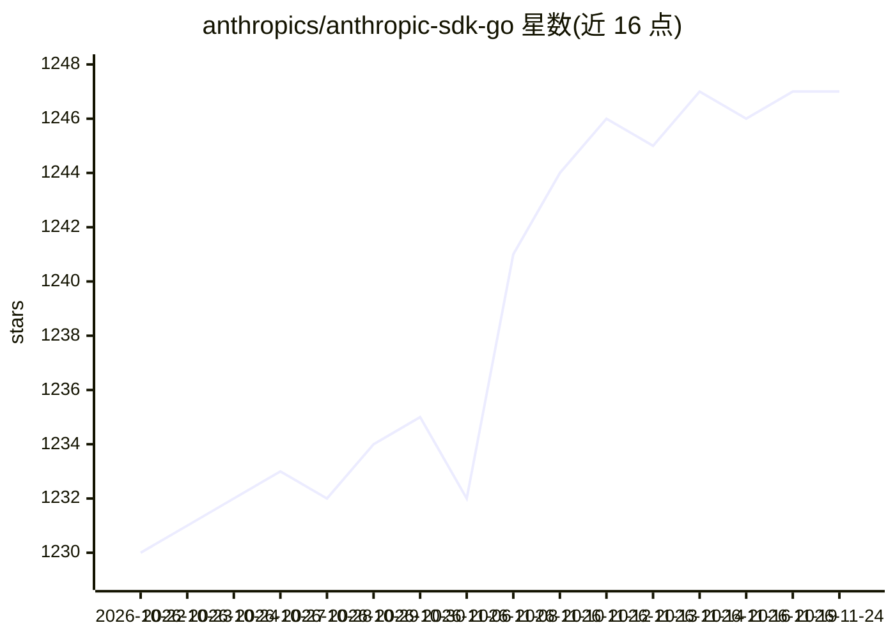

# anthropics/anthropic-sdk-go

⭐ 1,247 · Go · Apache-2.0 · 推送 2026-11-20 · [GitHub](https://github.com/anthropics/anthropic-sdk-go) · 组织维护

**Go 应用接入 Claude API 的官方 SDK**

Anthropic 官方提供的 Go 语言 SDK，使 Go 应用能够调用 Claude API。通过 go get 或 import 引入依赖，提供 Go Reference 文档，要求 Go 1.25 及以上版本，采用 Apache 2.0 许可（此前版本及早期第三方贡献保留 MIT 许可）。README 覆盖安装、快速开始示例与文档链接。

## 筛选速览

| 维度 | 判定 | 备注 |
|---|---|---|
| AI 角色 | `ai-ecosystem` | LLM/agent 周边工具 |
| 许可风险 | `permissive` | Apache-2.0 |
| 部署形态 | `None` |  |
| 模型依赖 | locked-api |  |
| 硬件要求 | — | 无带数字的原话,不猜 |
| 安装摩擦 | `low` | 无编译、无系统依赖或容器化 |
| 成熟度 | — | 结构信号不足 |

## 能力要点

- 从 Go 应用访问 Claude API 的官方 SDK
- 提供 go get 安装与 go import 引入两种依赖方式
- 文档托管于 platform.claude.com
- Apache 2.0 许可，历史版本保留 MIT

## 适用场景

- 在 Go 后端服务中调用 Claude API
- 为 Go 项目接入 Anthropic 模型能力

## 场景标签

`模型网关` · 领域:Agent 开发

## 证据(README 行号)

> L5: The Anthropic SDK for Go provides access to the Claude API from Go applications.
> L22: go get -u 'github.com/anthropics/anthropic-sdk-go/v2@v2.13.0'

## 星数曲线

2026-10-22 1,230 → 2026-11-24 1,247（+17）

---
*卡片 v1 · prompt 1.4 · 生成 2026-11-24 · 置信度 high · 依据 README sha `a8f550a04c58` · [字段定义](../../DATASET.md)*
