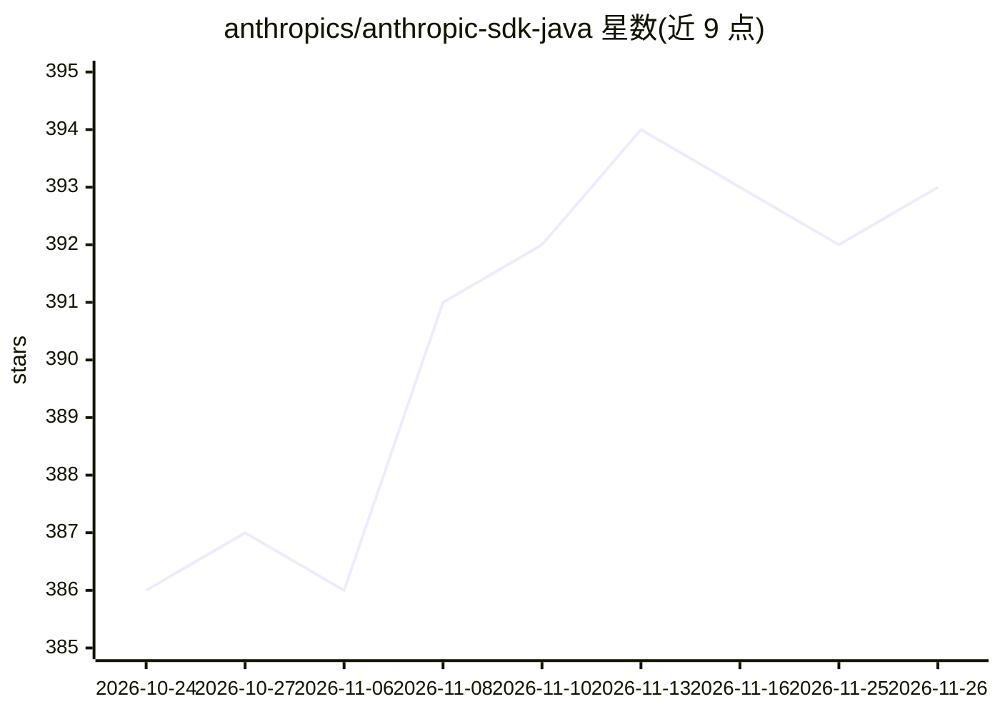

# anthropics/anthropic-sdk-java

⭐ 393 · Kotlin · Apache-2.0 · 推送 2026-11-24 · [GitHub](https://github.com/anthropics/anthropic-sdk-java) · 组织维护

**Java 应用接入 Claude API 的官方 SDK**

Anthropic 官方 Java SDK，通过 Maven Central 分发，提供 AnthropicClient（含基于 OkHttp 的客户端实现）与消息模型类，供 Java 应用调用 Claude API。安装方式为 Gradle 或 Maven 添加依赖。要求 Java 8 及以上。文档位于 platform.claude.com。许可证历史上为 MIT，当前版本为 Apache License 2.0，早期发布版本及此前合并的第三方贡献仍保留 MIT 许可。

## 筛选速览

| 维度 | 判定 | 备注 |
|---|---|---|
| AI 角色 | `ai-ecosystem` | LLM/agent 周边工具 |
| 许可风险 | `permissive` | Apache-2.0 |
| 部署形态 | `None` |  |
| 模型依赖 | locked-api |  |
| 硬件要求 | — | 无带数字的原话,不猜 |
| 安装摩擦 | `medium` | 含编译或系统依赖之一 |
| 成熟度 | — | 结构信号不足 |

## 能力要点

- 官方 Claude API Java SDK，经 Maven Central 分发
- 提供同步 OkHttp 客户端 AnthropicOkHttpClient 与消息模型
- 支持 Gradle 与 Maven 两种依赖管理方式安装

## 适用场景

- 在 Java 后端服务中调用 Claude API 生成文本
- 为已有 Java 应用集成 Anthropic 消息接口

## 场景标签

 · 领域:LLM 基础设施/SDK

## 证据(README 行号)

> L5: The Anthropic SDK for Java provides access to the Claude API from Java applications.
> L16: implementation("com.anthropic:anthropic-java:3.14.0")

## 星数曲线

2026-10-24 386 → 2026-11-26 393（+7）

---
*卡片 v1 · prompt 1.4 · 生成 2026-11-26 · 置信度 high · 依据 README sha `f174e372de74` · [字段定义](../../DATASET.md)*
