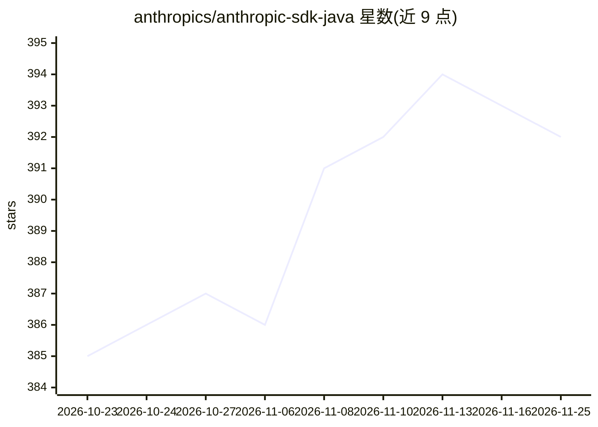

# anthropics/anthropic-sdk-java

⭐ 392 · Kotlin · Apache-2.0 · 推送 2026-11-23 · [GitHub](https://github.com/anthropics/anthropic-sdk-java) · 组织维护

**Java 应用接入 Claude API 的官方 SDK**

Anthropic 官方 Java SDK，提供从 Java 应用访问 Claude API 的客户端能力。通过 Maven Central 发布，支持 Gradle 与 Maven 依赖引入，提供 AnthropicClient/AnthropicOkHttpClient 客户端类与 messages 消息模型，要求 Java 8 及以上。采用 Apache License 2.0，早期版本及此前的第三方贡献仍适用 MIT 许可。

## 筛选速览

| 维度 | 判定 | 备注 |
|---|---|---|
| AI 角色 | `ai-ecosystem` | LLM/agent 周边工具 |
| 许可风险 | `permissive` | Apache-2.0 |
| 部署形态 | `None` |  |
| 模型依赖 | locked-api |  |
| 硬件要求 | — | 无带数字的原话,不猜 |
| 安装摩擦 | `medium` | 含编译或系统依赖之一 |
| 成熟度 | — | 结构信号不足 |

## 能力要点

- 官方维护，发布于 Maven Central（当前版本 3.13.0）
- 支持 Gradle 与 Maven 两种依赖管理方式
- 提供同步 OkHttp 客户端与 messages 消息模型
- 兼容 Java 8+

## 适用场景

- 在 Java 后端服务中调用 Claude API 生成或处理文本
- 为现有 Java 应用集成 Claude 消息能力

## 场景标签

 · 领域:LLM 基础设施/SDK

## 证据(README 行号)

> L5: The Anthropic SDK for Java provides access to the Claude API from Java applications.
> L1: # Anthropic SDK for Java

## 星数曲线

2026-10-23 385 → 2026-11-25 392（+7）

---
*卡片 v1 · prompt 1.4 · 生成 2026-11-25 · 置信度 high · 依据 README sha `9a3406166441` · [字段定义](../../DATASET.md)*
