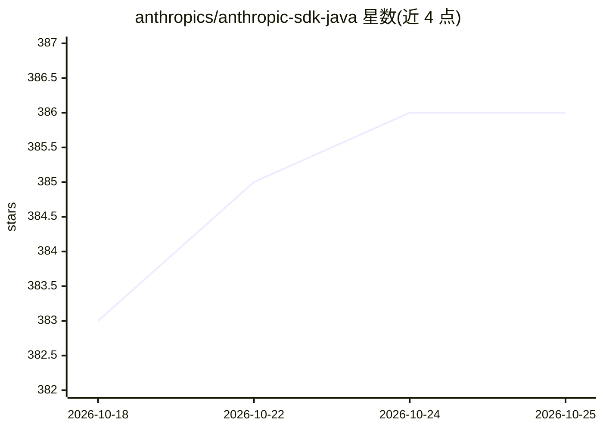

# anthropics/anthropic-sdk-java

⭐ 386 · Kotlin · Apache-2.0 · 推送 2026-10-23 · [GitHub](https://github.com/anthropics/anthropic-sdk-java) · 组织维护

**Java 应用接入 Claude API 的官方 SDK**

Anthropic 官方维护的 Java SDK，供 Java 应用调用 Claude API：提供 AnthropicClient 客户端与消息模型（如 Message），通过 Gradle 或 Maven 从 Maven Central 引入（当前版本 2.75.0）。要求 Java 8 及以上。文档托管于 platform.claude.com，采用 OkHttp 客户端实现（AnthropicOkHttpClient）。项目以 MIT 许可证发布。

## 筛选速览

| 维度 | 判定 | 备注 |
|---|---|---|
| AI 角色 | `ai-ecosystem` | LLM/agent 周边工具 |
| 许可风险 | `permissive` | Apache-2.0 |
| 部署形态 | `None` |  |
| 模型依赖 | locked-api |  |
| 硬件要求 | — | 无带数字的原话,不猜 |
| 安装摩擦 | `medium` | 含编译或系统依赖之一 |
| 成熟度 | — | 结构信号不足 |

## 能力要点

- 提供 Claude API 的 Java 客户端封装（AnthropicClient）
- 通过 Gradle/Maven 从 Maven Central 分发
- 要求 Java 8+，示例含 OkHttp 客户端构建方式

## 适用场景

- 在 Java 服务中集成 Claude 对话/消息能力
- 企业 Java 技术栈接入 Claude API

## 场景标签

 · 领域:LLM 基础设施/API SDK

## 证据(README 行号)

> L5: The Claude SDK for Java provides access to the Claude API from Java applications.
> L32: import com.anthropic.client.AnthropicClient;

## 星数曲线

2026-10-18 383 → 2026-10-25 386（+3）

---
*卡片 v1 · prompt 1.4 · 生成 2026-10-21 · 置信度 high · 依据 README sha `06c21eb28d65` · [字段定义](../../DATASET.md)*
