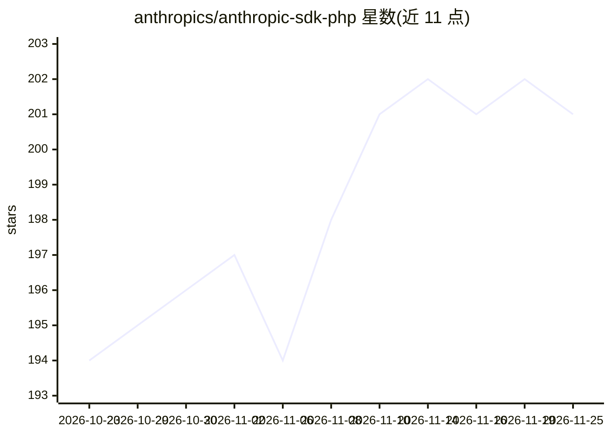

# anthropics/anthropic-sdk-php

⭐ 201 · PHP · Apache-2.0 · 推送 2026-11-23 · [GitHub](https://github.com/anthropics/anthropic-sdk-php) · 组织维护

**PHP 开发者接入 Claude API 的官方 SDK**

由 Anthropic 维护的 PHP SDK，为 PHP 应用提供访问 Claude API 的能力。通过 Composer 安装，要求 PHP 8.1.0+，并依赖 PSR-18 HTTP 客户端（未安装时可添加 Guzzle）。文档位于 platform.claude.com，采用 Apache 2.0 许可，早期版本及此前合并的第三方贡献保留 MIT 许可。

## 筛选速览

| 维度 | 判定 | 备注 |
|---|---|---|
| AI 角色 | `ai-ecosystem` | LLM/agent 周边工具 |
| 许可风险 | `permissive` | Apache-2.0 |
| 部署形态 | `None` |  |
| 模型依赖 | locked-api |  |
| 硬件要求 | — | 无带数字的原话,不猜 |
| 安装摩擦 | `low` | 无编译、无系统依赖或容器化 |
| 成熟度 | — | 结构信号不足 |

## 能力要点

- PHP 应用访问 Claude API 的官方 SDK
- Composer 安装（anthropic-ai/sdk ^1.13.0）
- 依赖 PSR-18 HTTP 客户端，可选搭配 Guzzle
- Apache 2.0 许可，早期版本保留 MIT 许可

## 适用场景

- 在 PHP 项目中调用 Claude 模型 API
- 为 PHP 后端应用接入 Anthropic 模型服务

## 场景标签

 · 领域:LLM 基础设施/SDK

## 证据(README 行号)

> L5: The Anthropic SDK for PHP provides access to the Claude API from PHP applications.
> L14: composer require "anthropic-ai/sdk:^1.13.0"

## 星数曲线

2026-10-23 194 → 2026-11-25 201（+7）

---
*卡片 v1 · prompt 1.4 · 生成 2026-11-25 · 置信度 high · 依据 README sha `7dfc76ed2cbf` · [字段定义](../../DATASET.md)*
