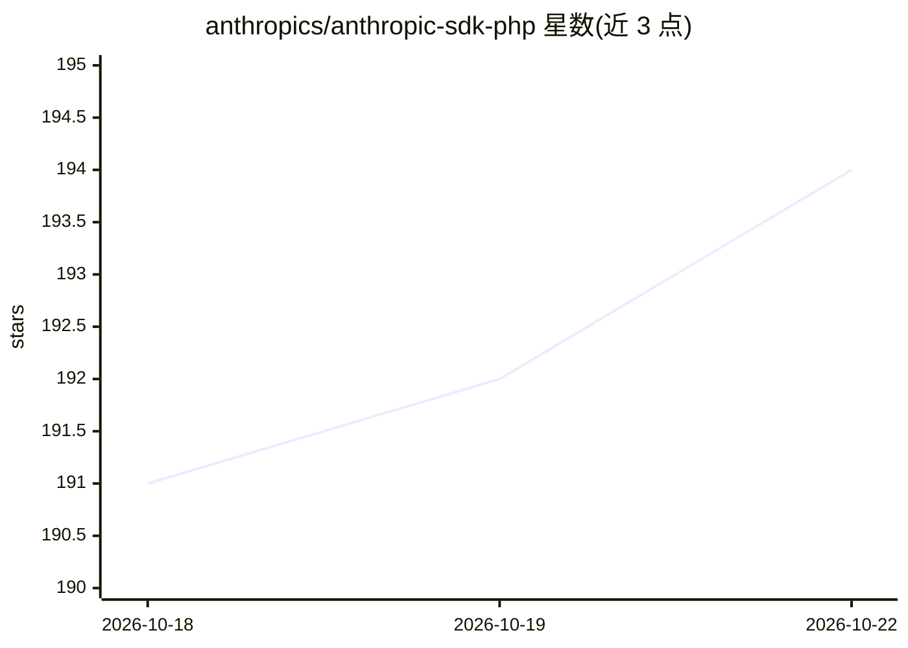

# anthropics/anthropic-sdk-php

⭐ 194 · PHP · MIT · 推送 2026-10-20 · [GitHub](https://github.com/anthropics/anthropic-sdk-php) · 组织维护

**官方 PHP SDK：在 PHP 应用中访问 Claude API**

Anthropic 官方维护的 PHP 客户端库，通过 Composer 安装，需自备 PSR-18 HTTP 客户端（如 Guzzle）。提供 SSE 流式响应与 MessageAccumulator 折叠、PHP 类定义结构化输出 Schema 并解析为类型化对象、列表自动分页迭代器、默认 2 次指数退避重试、文件上传参数、未文档化参数/端点访问与中间件管道（拦截日志/加头/缓存等）。内建 OpenTelemetry 追踪（可配置内容模式与传播开关）。要求 PHP 8.1+，主版本 0，API 可能变动。

## 筛选速览

| 维度 | 判定 | 备注 |
|---|---|---|
| AI 角色 | `ai-ecosystem` | LLM/agent 周边工具 |
| 许可风险 | `permissive` | MIT |
| 部署形态 | `None` |  |
| 模型依赖 | locked-api |  |
| 硬件要求 | — | 无带数字的原话,不猜 |
| 安装摩擦 | `low` | 无编译、无系统依赖或容器化 |
| 成熟度 | `idea` | |

## 能力要点

- SSE 流式响应与 MessageAccumulator 流中折叠
- PHP 类定义结构化输出 Schema，响应解析为类型化对象
- 列表方法自动分页迭代器与默认重试（指数退避）
- 中间件管道与内建 OpenTelemetry span 上报

## 适用场景

- 在 PHP 应用中调用 Claude Messages API
- 以类型化 PHP 类约束模型结构化输出
- 对 API 调用链路做日志拦截与追踪埋点

## 场景标签

 · 领域:LLM 基础设施/SDK

## 证据(README 行号)

> L5: The Claude SDK for PHP provides access to the Claude API from PHP applications.
> L14: composer require "anthropic-ai/sdk:^0.61.0"
> L237: PHP 8.1.0+

## 星数曲线

2026-10-18 191 → 2026-10-22 194（+3）

---
*卡片 v1 · prompt 1.4 · 生成 2026-10-22 · 置信度 high · 依据 README sha `19342d11a91f` · [字段定义](../../DATASET.md)*
