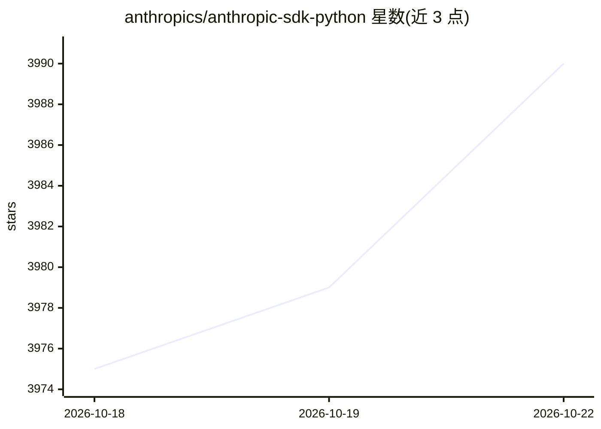

# anthropics/anthropic-sdk-python

⭐ 3,990 · Python · MIT · 推送 2026-10-20 · [GitHub](https://github.com/anthropics/anthropic-sdk-python) · 组织维护

**Anthropic 官方 Python SDK，供应用访问 Claude API**

由 Anthropic 官方维护的 Python 库，封装 Claude API 的调用，提供客户端类、工具辅助（@beta_tool、tool runner、ToolError）及浏览器与计算机工具集类的单独文档。内置 OpenTelemetry 集成，每次 API 调用上报为 span，依赖 opentelemetry-api，可通过环境变量控制 span 开关、内容记录与字节数上限。要求 Python 3.10+，MIT 许可，通过 pip 安装。

## 筛选速览

| 维度 | 判定 | 备注 |
|---|---|---|
| AI 角色 | `ai-ecosystem` | LLM/agent 周边工具 |
| 许可风险 | `permissive` | MIT |
| 部署形态 | `library` | 以包/库形式分发 |
| 模型依赖 | locked-api |  |
| 硬件要求 | — | 无带数字的原话,不猜 |
| 安装摩擦 | `low` | 无编译、无系统依赖或容器化 |
| 成熟度 | — | 结构信号不足 |

## 能力要点

- 提供 Claude API 的 Python 客户端访问
- 工具辅助与浏览器/计算机工具集类
- 内置 OpenTelemetry span 上报，环境变量可配置
- MIT 许可，要求 Python 3.10+

## 适用场景

- 在 Python 应用中调用 Claude API
- 通过 OpenTelemetry 追踪 LLM API 调用
- 构建带工具调用的 Claude 应用

## 场景标签

 · 领域:LLM API/开发库

## 证据(README 行号)

> L5: The Claude SDK for Python provides access to the Claude API from Python applications.
> L16: pip install anthropic

## 星数曲线

2026-10-18 3,975 → 2026-10-22 3,990（+15）

---
*卡片 v1 · prompt 1.4 · 生成 2026-10-20 · 置信度 high · 依据 README sha `9990d3a64e68` · [字段定义](../../DATASET.md)*
