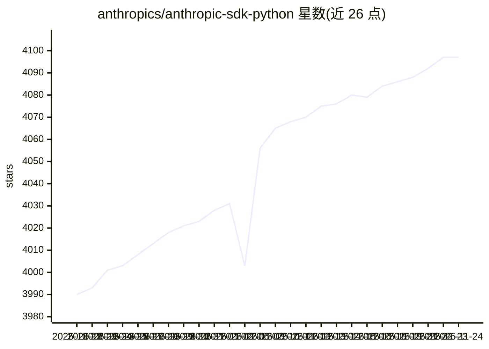

# anthropics/anthropic-sdk-python

⭐ 4,097 · Python · Apache-2.0 · 推送 2026-11-20 · [GitHub](https://github.com/anthropics/anthropic-sdk-python) · 组织维护

**供 Python 应用接入 Claude API 的官方 SDK**

Anthropic 官方 Python SDK，为 Python 应用提供访问 Claude API 的入口：pip 安装后导入客户端即可发起请求。README 要求 Python 3.10+，完整文档托管在 platform.claude.com。采用 Apache 2.0 许可，从 MIT 变更前的旧版本及此前合并的第三方贡献仍保留 MIT 许可，提供 v1 迁移指南。

## 筛选速览

| 维度 | 判定 | 备注 |
|---|---|---|
| AI 角色 | `ai-ecosystem` | LLM/agent 周边工具 |
| 许可风险 | `permissive` | Apache-2.0 |
| 部署形态 | `library` | 以包/库形式分发 |
| 模型依赖 | locked-api |  |
| 硬件要求 | — | 无带数字的原话,不猜 |
| 安装摩擦 | `low` | 无编译、无系统依赖或容器化 |
| 成熟度 | — | 结构信号不足 |

## 能力要点

- 从 Python 应用访问 Claude API 的官方 SDK
- 提供 v1 迁移指南（0.x 升级）
- Apache 2.0 许可，历史版本保留 MIT

## 适用场景

- 在 Python 应用中调用 Claude API
- 将旧版 0.x SDK 升级到 v1

## 场景标签

 · 领域:LLM 基础设施/API 客户端

## 证据(README 行号)

> L5: The Anthropic SDK for Python provides access to the Claude API from Python applications.
> L14: pip install anthropic

## 星数曲线

2026-10-22 3,990 → 2026-11-24 4,097（+107）

---
*卡片 v1 · prompt 1.4 · 生成 2026-11-23 · 置信度 high · 依据 README sha `613a3c663135` · [字段定义](../../DATASET.md)*
