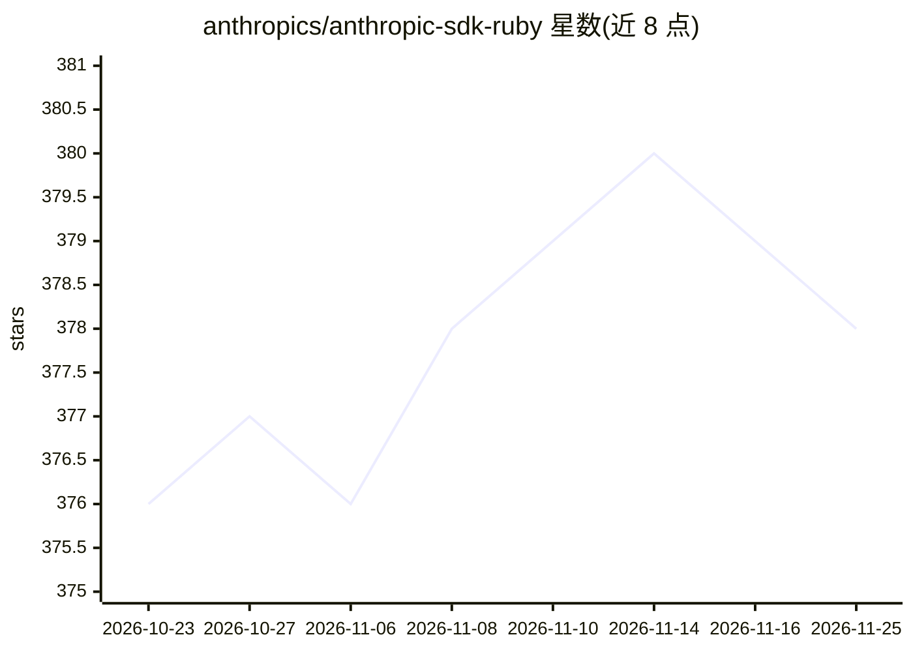

# anthropics/anthropic-sdk-ruby

⭐ 378 · Ruby · Apache-2.0 · 推送 2026-11-23 · [GitHub](https://github.com/anthropics/anthropic-sdk-ruby) · 组织维护

**Ruby 应用接入 Claude API 的官方 SDK**

Anthropic 官方维护的 Ruby 语言 SDK，让 Ruby 应用能够访问 Claude API。通过 Gemfile 添加依赖即可安装，README 提供初始化调用的入门代码示例，要求 Ruby 3.2.0 以上版本。采用 Apache License 2.0 许可，此前的旧版本及早期第三方贡献仍遵循 MIT 许可（存在双许可历史）。文档托管于 platform.claude.com。

## 筛选速览

| 维度 | 判定 | 备注 |
|---|---|---|
| AI 角色 | `ai-ecosystem` | LLM/agent 周边工具 |
| 许可风险 | `permissive` | Apache-2.0 |
| 部署形态 | `None` |  |
| 模型依赖 | locked-api |  |
| 硬件要求 | — | 无带数字的原话,不猜 |
| 安装摩擦 | `low` | 无编译、无系统依赖或容器化 |
| 成熟度 | — | 结构信号不足 |

## 能力要点

- 官方 Ruby SDK，提供 Claude API 访问
- 通过 Gemfile 安装（anthropic gem ~> 2.13.0）
- 要求 Ruby 3.2.0+
- Apache-2.0 与 MIT 双许可历史声明

## 适用场景

- 在 Ruby 项目中调用 Claude API
- 为 Ruby 应用集成大模型对话能力

## 场景标签

 · 领域:LLM 基础设施/SDK

## 证据(README 行号)

> L1: # Anthropic SDK for Ruby
> L5: The Anthropic SDK for Ruby provides access to the Claude API from Ruby applications.

## 星数曲线

2026-10-23 376 → 2026-11-25 378（+2）

---
*卡片 v1 · prompt 1.4 · 生成 2026-11-25 · 置信度 high · 依据 README sha `163a2ee32317` · [字段定义](../../DATASET.md)*
