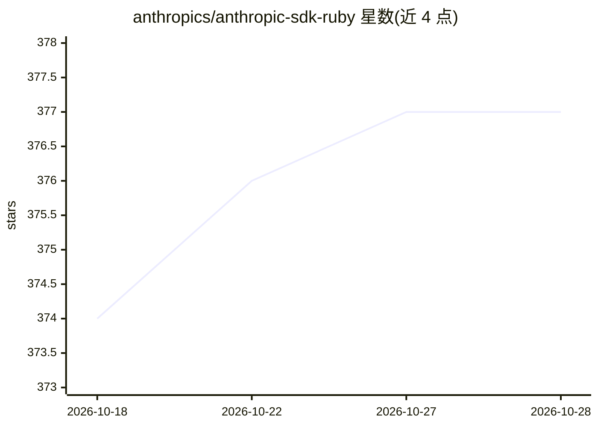

# anthropics/anthropic-sdk-ruby

⭐ 377 · Ruby · Apache-2.0 · 推送 2026-10-23 · [GitHub](https://github.com/anthropics/anthropic-sdk-ruby) · 组织维护

**Ruby 应用接入 Claude API 的官方 SDK**

Anthropic 官方维护的 Ruby 客户端库，通过 Gemfile 以 gem 'anthropic' 安装，要求 Ruby 3.2.0+。提供消息创建等 API 调用接口，文档托管在 platform.claude.com。内置 OpenTelemetry 支持：默认开启 span 上报，每次 API 调用生成 span 并在请求头携带 traceparent 等追踪上下文；可通过客户端选项或 ANTHROPIC_OPEN_TELEMETRY 系列环境变量调整 span 内容模式、字节上限与传播行为，并支持 gen_ai.conversation.id 标注。Gem 名称由社区开发者捐赠而来。

## 筛选速览

| 维度 | 判定 | 备注 |
|---|---|---|
| AI 角色 | `ai-ecosystem` | LLM/agent 周边工具 |
| 许可风险 | `permissive` | Apache-2.0 |
| 部署形态 | `None` |  |
| 模型依赖 | locked-api |  |
| 硬件要求 | — | 无带数字的原话,不猜 |
| 安装摩擦 | `low` | 无编译、无系统依赖或容器化 |
| 成熟度 | — | 结构信号不足 |

## 能力要点

- 以 Ruby gem 形式提供 Claude API 访问
- OpenTelemetry span 默认开启，每次 API 调用自动上报
- 客户端选项与环境变量两种方式配置追踪行为
- content 模式可将消息、停止序列与工具调用纳入 span

## 适用场景

- Ruby/Rails 应用中调用 Claude API 生成回复
- 通过 OpenTelemetry 追踪和观测 LLM 调用链路
- 按会话 ID 关联分析多轮请求

## 场景标签

 · 领域:LLM 基础设施/开发工具

## 证据(README 行号)

> L5: The Claude SDK for Ruby provides access to the Claude API from Ruby applications.
> L16: gem "anthropic", "~> 1.82.0"

## 星数曲线

2026-10-18 374 → 2026-10-28 377（+3）

---
*卡片 v1 · prompt 1.4 · 生成 2026-10-21 · 置信度 high · 依据 README sha `d724c807346d` · [字段定义](../../DATASET.md)*
