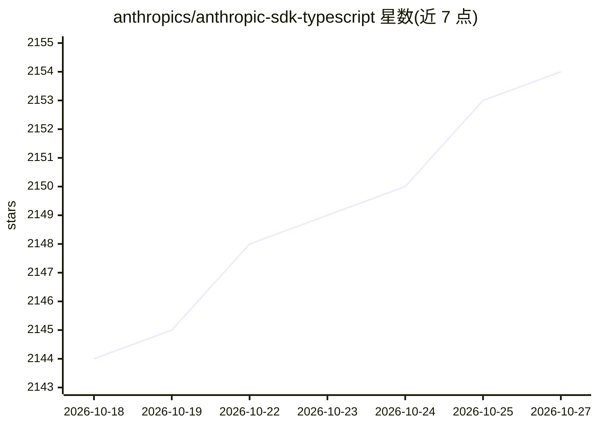

# anthropics/anthropic-sdk-typescript

⭐ 2,154 · TypeScript · Apache-2.0 · 推送 2026-10-23 · [GitHub](https://github.com/anthropics/anthropic-sdk-typescript) · [官网](https://www.npmjs.com/package/@anthropic-ai/sdk) · 组织维护

**Anthropic 官方 TypeScript SDK：在 TS/JS 应用中调用 Claude API**

Anthropic 官方维护的 TypeScript/JavaScript SDK，供服务端应用访问 Claude API。提供流式输出、结构化输出、工具助手与工具运行器等辅助功能，并内置浏览器与计算机工具集类的独立指南。支持 Node.js 20+、Deno、Bun、Cloudflare Workers、Vercel Edge 等运行时；浏览器支持默认关闭以避免泄露 API 密钥，React Native 暂不支持。集成了 OpenTelemetry 追踪，每次 API 调用默认上报为 span，可通过客户端选项或环境变量配置。

## 筛选速览

| 维度 | 判定 | 备注 |
|---|---|---|
| AI 角色 | `ai-ecosystem` | LLM/agent 周边工具 |
| 许可风险 | `permissive` | Apache-2.0 |
| 部署形态 | `library` | 以包/库形式分发 |
| 模型依赖 | locked-api |  |
| 硬件要求 | — | 无带数字的原话,不猜 |
| 安装摩擦 | `low` | 无编译、无系统依赖或容器化 |
| 成熟度 | — | 结构信号不足 |

## 能力要点

- 提供流式输出、结构化输出、工具助手与工具运行器等 SDK 辅助功能
- 支持 Node.js/Deno/Bun/Cloudflare Workers/Vercel Edge 等多种运行时
- OpenTelemetry 集成：API 调用默认生成 span，支持内容模式与传播配置
- 浏览器支持默认禁用，需显式设置 dangerouslyAllowBrowser 开启

## 适用场景

- 在 TypeScript/Node.js 服务端应用中调用 Claude API
- 为 Claude 应用接入 OpenTelemetry 可观测性
- 在边缘运行时（Cloudflare Workers/Vercel Edge）中使用 Claude SDK

## 场景标签

 · 领域:LLM 基础设施/开发 SDK

## 证据(README 行号)

> L5: The Claude SDK for TypeScript provides access to the Claude API from server-side TypeScript or JavaScript applicatio
> L9: SDK helpers (streaming, structured outputs, tool helpers and the tool runner) are documented in helpers.md. The brow

## 星数曲线

2026-10-18 2,144 → 2026-10-27 2,154（+10）

---
*卡片 v1 · prompt 1.4 · 生成 2026-10-21 · 置信度 high · 依据 README sha `4db66f379e55` · [字段定义](../../DATASET.md)*
