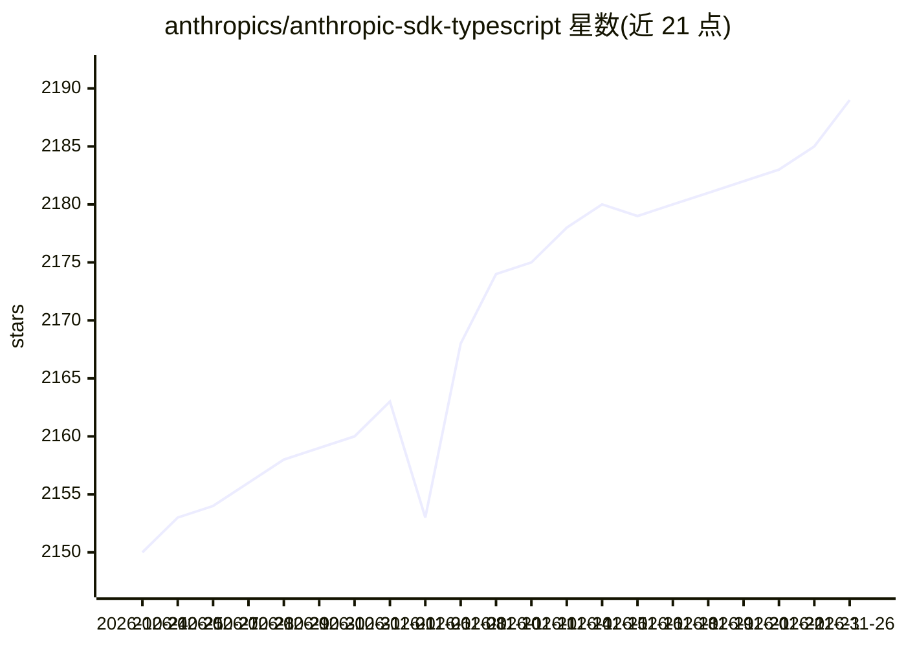

# anthropics/anthropic-sdk-typescript

⭐ 2,189 · TypeScript · Apache-2.0 · 推送 2026-11-24 · [GitHub](https://github.com/anthropics/anthropic-sdk-typescript) · [官网](https://www.npmjs.com/package/@anthropic-ai/sdk) · 组织维护

**面向服务端 TypeScript/JavaScript 开发者的 Claude API 官方 SDK**

官方 TypeScript SDK，供服务端 TS/JS 应用接入 Claude API。通过 npm 安装，代码示例展示客户端初始化与调用方式。支持 Node.js 20+、Deno、Bun、Cloudflare Workers、Vercel Edge、Nitro 等运行时；浏览器默认禁用以防 API 密钥泄露，需显式开启；React Native 目前不支持。采用 Apache 2.0 许可，早期版本及此前合并的第三方贡献保留 MIT 许可。

## 筛选速览

| 维度 | 判定 | 备注 |
|---|---|---|
| AI 角色 | `ai-ecosystem` | LLM/agent 周边工具 |
| 许可风险 | `permissive` | Apache-2.0 |
| 部署形态 | `library` | 以包/库形式分发 |
| 模型依赖 | locked-api |  |
| 硬件要求 | — | 无带数字的原话,不猜 |
| 安装摩擦 | `low` | 无编译、无系统依赖或容器化 |
| 成熟度 | — | 结构信号不足 |

## 能力要点

- 支持 Node.js/Deno/Bun/Cloudflare Workers/Vercel Edge 等多种运行时
- 浏览器默认禁用，需显式设置 dangerouslyAllowBrowser
- npm 安装，TypeScript >= 5.0

## 适用场景

- 在服务端 TypeScript/JavaScript 应用中调用 Claude API
- 在 Edge 运行时（Cloudflare Workers/Vercel Edge）中接入 Claude

## 场景标签

 · 领域:LLM 基础设施/SDK

## 证据(README 行号)

> L5: The Anthropic SDK for TypeScript provides access to the Claude API from server-side TypeScript or JavaScript applica
> L30: The following runtimes are supported:

## 星数曲线

2026-10-24 2,150 → 2026-11-26 2,189（+39）

---
*卡片 v1 · prompt 1.4 · 生成 2026-11-23 · 置信度 high · 依据 README sha `d88edee46832` · [字段定义](../../DATASET.md)*
