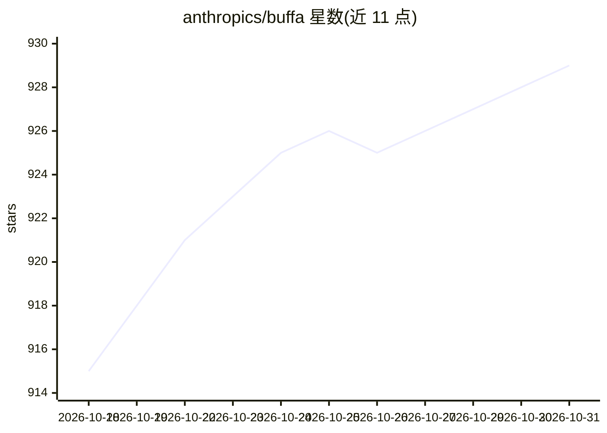

# anthropics/buffa

⭐ 929 · Rust · Apache-2.0 · 推送 2026-10-25 · [GitHub](https://github.com/anthropics/buffa) · 组织维护

**纯 Rust 的 Protocol Buffers 实现，支持 editions 与零拷贝视图**

以 protobuf editions 为核心抽象的纯 Rust 序列化库，proto2/proto3 作为 editions 的特性预设处理。支持 binary、JSON、text 三种编码，通过完整 protobuf 一致性测试套件。每类消息同时生成拥有型与零拷贝借用视图两类类型，核心运行时支持 no_std + alloc，提供运行时反射（DescriptorPool/DynamicMessage）与 gRPC 服务器反射符号查找。提供 buf 远程插件、protoc 插件与 build.rs 工作流；明确不支持 proto2 optional 自定义默认值 getter，pre-1.0 版本按 0.x 惯例小版本含破坏性变更。

## 筛选速览

| 维度 | 判定 | 备注 |
|---|---|---|
| AI 角色 | `ai-ecosystem` | LLM/agent 周边工具 |
| 许可风险 | `permissive` | Apache-2.0 |
| 部署形态 | `library` | 以包/库形式分发 |
| 模型依赖 | — | README 未给出锁定关系 |
| 硬件要求 | — | 无带数字的原话,不猜 |
| 安装摩擦 | `low` | 无编译、无系统依赖或容器化 |
| 成熟度 | — | 结构信号不足 |

## 能力要点

- 每消息生成 owned 与 zero-copy View 两层类型
- 通过 binary/JSON/text 完整 protobuf 一致性套件
- no_std + alloc 核心，含 serde JSON 序列化
- 运行时反射支持免生成代码的编解码与 gRPC 服务器反射

## 适用场景

- 在 Rust 项目中做 protobuf 编解码替代现有 prost/protobuf 方案
- 嵌入或网络中间件场景需要零拷贝解析与未知字段保留
- 构建 gRPC 服务反射或 CEL 求值器/转码网关

## 场景标签

 · 领域:序列化/网络协议库

## 证据(README 行号)

> L11: A pure-Rust Protocol Buffers implementation with first-class protobuf editions support. Written by Claude and frien
> L15: The Rust ecosystem lacks an actively maintained, pure-Rust library that supports protobuf editions. Buffa fills tha

## 星数曲线

2026-10-18 915 → 2026-10-31 929（+14）

---
*卡片 v1 · prompt 1.4 · 生成 2026-10-21 · 置信度 low · 依据 README sha `c6b145d11d31` · [字段定义](../../DATASET.md)*
