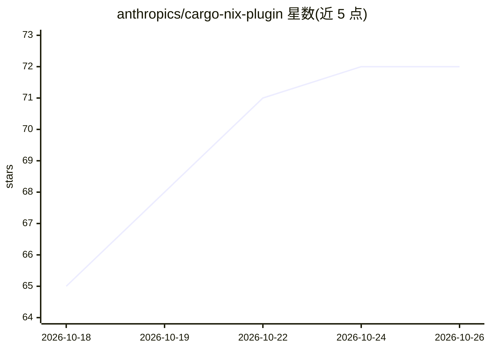

# anthropics/cargo-nix-plugin

⭐ 72 · Rust · Apache-2.0 · 推送 2026-10-16 · [GitHub](https://github.com/anthropics/cargo-nix-plugin) · 组织维护

**Nix 插件：原生解析 Cargo workspace，按 crate 构建 Rust 项目**

由 Anthropic 维护的 Nix 语言插件与封装库：向 Nix 添加 builtins.resolveCargoWorkspace primop，直接读取 Cargo.lock 与稀疏注册表索引（评估期无需 cargo 二进制），或解析预生成的 cargo metadata JSON，解析依赖、特性与平台条件表达式，输出接入 buildRustCrate 的 attrset，替代 crate2nix 生成并提交数万行 Cargo.nix 的流程。附带缓存的 clippy 检查、单元测试与 doctest 封装。限制：插件必须与编译时所用的 Nix 版本一致（默认 Nix 2.34）。

## 筛选速览

| 维度 | 判定 | 备注 |
|---|---|---|
| AI 角色 | `ai-enhanced` | 去掉 AI 部分产品仍成立 |
| 许可风险 | `permissive` | Apache-2.0 |
| 部署形态 | `library` | 以包/库形式分发 |
| 模型依赖 | — | README 未给出锁定关系 |
| 硬件要求 | — | 无带数字的原话,不猜 |
| 安装摩擦 | `low` | 无编译、无系统依赖或容器化 |
| 成熟度 | — | 结构信号不足 |

## 能力要点

- 读取 Cargo.lock 与稀疏索引，评估期无需 cargo 二进制
- 以单个 primop 替代 crate2nix 生成的 Cargo.nix 文件
- 缓存式 clippy 检查，依赖与常规构建共享 Nix store 路径
- 支持单元测试与 doctest 的封装推导

## 适用场景

- 在 Nix 中按 crate 构建大型 Rust workspace，免去生成 Cargo.nix
- 在 CI 中运行缓存的 clippy 检查并发布 JSON 诊断
- 离线/镜像环境下预取 cargo 注册表索引后解析依赖

## 场景标签

 · 领域:构建工具/Rust

## 证据(README 行号)

> L1: # cargo-nix-plugin
> L3: A Nix plugin that resolves Cargo workspaces natively, replacing the generated
> L309: 1. **Nix plugin**: Adds a `builtins.resolveCargoWorkspace` primop to Nix. When

## 星数曲线

2026-10-18 65 → 2026-10-26 72（+7）

---
*卡片 v1 · prompt 1.4 · 生成 2026-10-24 · 置信度 low · 依据 README sha `854599338df6` · [字段定义](../../DATASET.md)*
