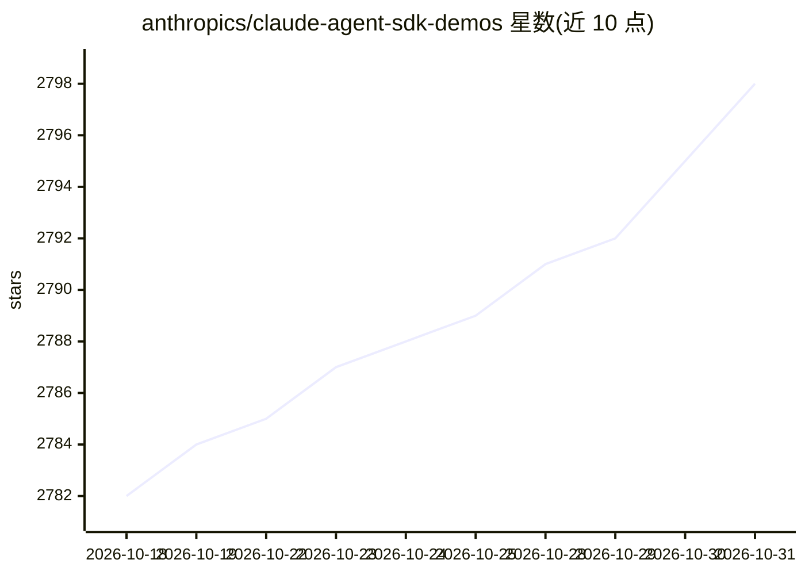

# anthropics/claude-agent-sdk-demos

⭐ 2,798 · TypeScript · 推送 2026-08-27 · [GitHub](https://github.com/anthropics/claude-agent-sdk-demos) · [官网](https://docs.claude.com/en/docs/claude-code/sdk/sdk-typescript) · 组织维护

**Anthropic 官方的 Claude Agent SDK 示例应用合集**

Anthropic 维护的演示仓库，含 8 个基于 Claude Agent SDK 的示例：IMAP 邮件助手（开发中）、Excel 表格操作、Hello World 入门、V2 Session API 会话持久化示例、多子代理并行调研并生成报告的 Research Agent、AskUserQuestion HTML 预览卡片的品牌助手、React+Express 流式聊天应用，以及通过网页搜索生成单页 .docx 简历的生成器。面向开发者学习 SDK 用法；需 Bun 或 Node.js 18+ 与 Anthropic API key，各示例目录内含独立安装说明，明确声明仅供本地开发、不建议生产部署。

## 筛选速览

| 维度 | 判定 | 备注 |
|---|---|---|
| AI 角色 | `ai-ecosystem` | LLM/agent 周边工具 |
| 许可风险 | `none` | — |
| 部署形态 | `None` |  |
| 模型依赖 | locked-api |  |
| 硬件要求 | — | 无带数字的原话,不猜 |
| 安装摩擦 | `low` | 无编译、无系统依赖或容器化 |
| 成熟度 | `idea` | |

## 能力要点

- 8 个覆盖不同 SDK 能力面的示例应用
- Research Agent 演示多子代理并行调研与报告合成
- React + Express 聊天应用展示 WebSocket 流式对话全环路
- AskUserQuestion 示例演示 HTML 预览卡片与 plan mode

## 适用场景

- 学习 Claude Agent SDK 的接入方式与 API 模式
- 参考多代理系统的子代理编排实现
- 以聊天或邮件助手示例为起点构建自己的 agent 应用

## 场景标签

`Agent 框架` `多智能体` · 领域:Agent 开发

## 证据(README 行号)

> L5: This repository contains multiple demonstrations of the Claude Agent SDK, showcasing different ways to build AI-powe
> L19: A simple getting-started example to help you understand the basics of the Claude Agent SDK.

## 星数曲线

2026-10-18 2,782 → 2026-10-31 2,798（+16）

---
*卡片 v1 · prompt 1.4 · 生成 2026-10-21 · 置信度 high · 依据 README sha `fd66ff911a95` · [字段定义](../../DATASET.md)*
