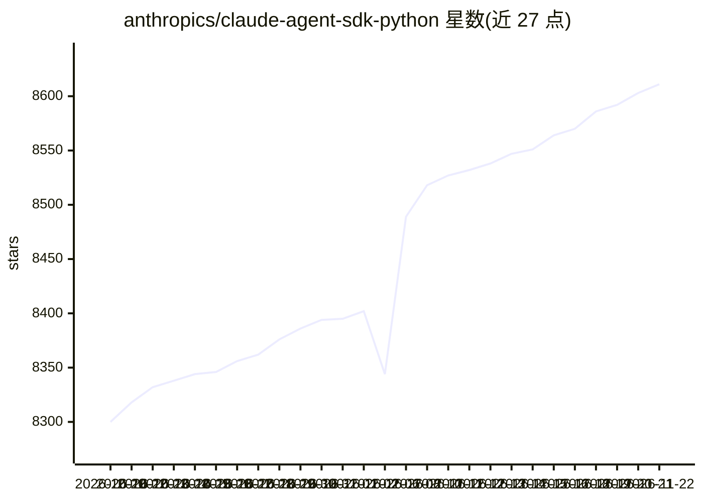

# anthropics/claude-agent-sdk-python

⭐ 8,611 · Python · MIT · 推送 2026-11-20 · [GitHub](https://github.com/anthropics/claude-agent-sdk-python) · 组织维护

**给 Python 开发者的 Claude Agent SDK，接入 Claude Code 构建智能体**

Anthropic 官方的 Python SDK，封装对 Claude Code 的调用：query() 异步函数返回消息流，ClaudeSDKClient 支持双向交互对话，并可用 Python 函数定义自定义工具（进程内 SDK MCP 服务器）与 hooks（在 agent 循环特定点触发确定性处理）。默认捆绑 Claude Code CLI 无需单独安装，也可指定系统安装路径。要求 Python 3.10+，通过 pip 安装，使用受 Anthropic 商业服务条款约束。

## 筛选速览

| 维度 | 判定 | 备注 |
|---|---|---|
| AI 角色 | `ai-ecosystem` | LLM/agent 周边工具 |
| 许可风险 | `permissive` | MIT |
| 部署形态 | `library` | 以包/库形式分发 |
| 模型依赖 | locked-api |  |
| 硬件要求 | — | 无带数字的原话,不猜 |
| 安装摩擦 | `low` | 无编译、无系统依赖或容器化 |
| 成熟度 | — | 结构信号不足 |

## 能力要点

- query() 异步接口返回 AsyncIterator 消息流
- ClaudeSDKClient 支持双向交互与自定义工具/hooks
- 自定义工具以进程内 SDK MCP 服务器实现，无需子进程
- pip 包自动捆绑 Claude Code CLI，可自定义 cli_path

## 适用场景

- 用 Python 脚本调用 Claude Code 执行文件读写等任务
- 为 agent 注册自定义 Python 工具与生命周期 hooks
- 构建流式交互式 agent 应用

## 场景标签

`Agent 框架` · 领域:Agent 开发

## 证据(README 行号)

> L1: # Claude Agent SDK for Python
> L3: Python SDK for Claude Agent. See the Claude Agent SDK documentation for more information.
> L75: `ClaudeSDKClient` supports bidirectional, interactive conversations with Claude

## 星数曲线

2026-10-20 8,300 → 2026-11-22 8,611（+311）

---
*卡片 v1 · prompt 1.4 · 生成 2026-11-22 · 置信度 high · 依据 README sha `d18c1252c457` · [字段定义](../../DATASET.md)*
